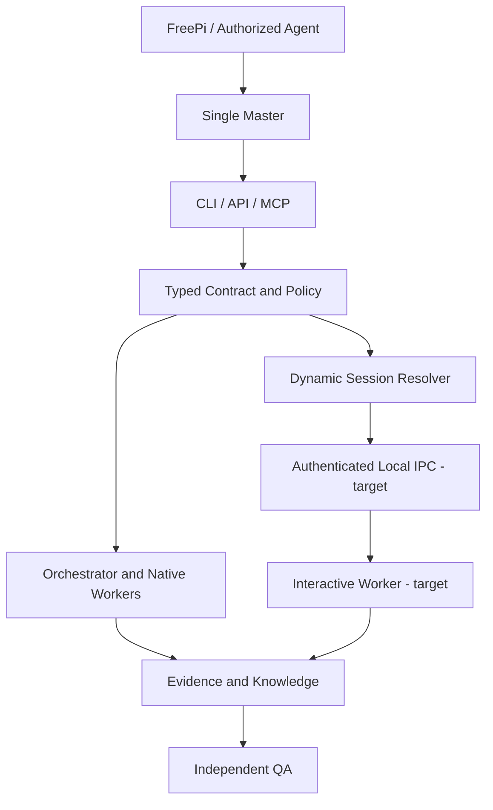

# NorthStar RE Framework

**منظومة ذكاء هندسي أصلية بـRust لمنصة Windows 11 x64**

`0.012` · **مرحلة تطوير قبل الإنتاج** · ماستر واحدة · 12 مجالًا للمحركات

[English](README.md) · [المعمارية](docs/architecture/overview.md) · [التوثيق](docs/README.md) · [خارطة التطوير](ROADMAP.md) · [التاريخ](CHANGELOG.md) · [سياسة الإصدار](docs/VERSIONING.md)

> الهوية الظاهرة المعتمدة هي 0.012. لا تزال شجرة التطوير الحالية تعرّف نفسها تقنيًا بـ`12.0.0-dev.1` إلى حين تنفيذ ترحيل SemVer إلى `0.0.12-dev.1` واختباره. لا يوجد إصدار إنتاجي معتمد، وتبقى RC2 التاريخية نقطة استعادة محفوظة.

## الهدف

طبقة تنفيذ هندسية محلية تستند إلى الأدلة وتعمل ضمن مشروع مصرح به. يختار الأيجنت التخصصات المناسبة ويستدعي عمليات Rust محددة العقود، بينما تتحقق طبقة ضمان الجودة من النتائج. نفصل الاستدلال عن التنفيذ والتحكم التفاعلي والأدلة.

## المعمارية

12 محركًا بأسمائها ومعرّفاتها الثابتة، و52 دليلًا داخليًا و108 مدخلات أدوات ومراجع. هذه الأعداد لا تعني اكتمال المحركات. الهدف Windows 11 x64/MSVC، دون بديل تشغيل Python.

## الوضع الهندسي الموثق

لقطة مؤرخة 27 نوفمبر 2026: [`d917cb5`](https://github.com/AlMagrhibi/-NorthStar-RE-/commit/d917cb562e9248e9f5a924eda42e311899149acd) · [PR #9](https://github.com/AlMagrhibi/-NorthStar-RE-/pull/9) · [CI 45927809158](https://github.com/AlMagrhibi/-NorthStar-RE-/actions/runs/45927809158). نجحت فحوص Native وSecurity وDistributions؛ النشر لم يُنفذ.

| المجال | الحالة عند اللقطة |
|---|---|
| الجرد والفهرسة وذاكرة المشروع | أساس منفذ |
| سجل المحركات والعمليات المحدودة | جزئي؛ كل complete=false |
| الطابور الدائم والتبعيات والـleases | أساس منفذ، والتصليب مستمر |
| مشرف العمليات | اختبارات أولية لعمليات فعلية؛ ملكية/موارد/استعادة قيد التطوير |
| اكتشاف الجلسات والسياق الديناميكي | أساس موجود؛ التقييم عند الاستدعاء |
| العامل التفاعلي وIPC وإعادة الاتصال | غير مقبول بعد |
| Adaptive Input والتحقق من الأثر | تطوير إضافي مطلوب |
| حزم التطوير | CI ناجح عند اللقطة؛ النشر غير مصرح |
| FreePi / SSH / سطح المكتب الفعلي | القبول معلق |

راجع [مصفوفة الأدلة](docs/reports/TEST-EVIDENCE-MATRIX.json) و[خارطة التنفيذ](ROADMAP.md). نتائج Windows 11 المحلية منفصلة عن Windows Server CI.

## الاستخدام والتثبيت

[دليل RC2 التاريخي](INSTALL.md) · [تثبيت الأيجنت](INSTALL-FOR-AGENTS.md) · [هندسة الإصدارات](RELEASE.md). حزم التطوير تختبر في بيئة معزولة دون استبدال التثبيت التاريخي.

## الحوكمة والتوثيق

[التوجيه الهندسي الموحد](docs/NORTHSTAR-V12-EXECUTION-DIRECTIVE.md) يحفظ ADD-001–042 وبوابات NSO/DSC/WISM/T01–42. الاسم التاريخي للملف باقٍ لضمان سلامة المراجع. لا تجاوز لقفل Windows أو حدود الصلاحيات، ولا إعادة تنفيذ مؤثرات مجهولة النتيجة، ولا نشر أسرار أو أدلة غير معقمة.

[الأمان](SECURITY.md) · [المساهمة](CONTRIBUTING.md) · [التطوير](docs/ar/development.md) · [CLI](docs/ar/cli.md) · [التخصصات](docs/ar/specialists.md) · [الأدوات](docs/ar/tools.md)

## التاريخ

المشروع في مرحلة مبكرة. تسميات V السابقة مراحل هندسية داخلية، وليست أجيالًا إنتاجية معتمدة. نحافظ على سجل Git والحزم والوسوم التاريخية دون إعادة كتابة أو تغيير تاريخ الأدلة. [التوثيق العربي السابق في لقطة ثابتة](https://github.com/AlMagrhibi/-NorthStar-RE-/blob/d917cb562e9248e9f5a924eda42e311899149acd/README.ar.md).
