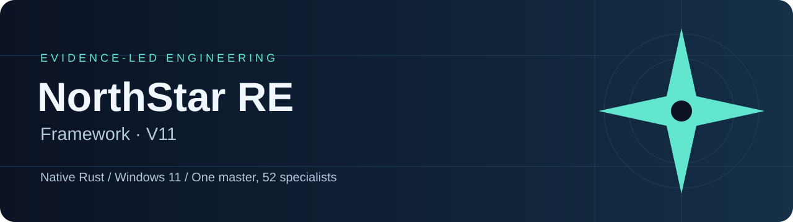
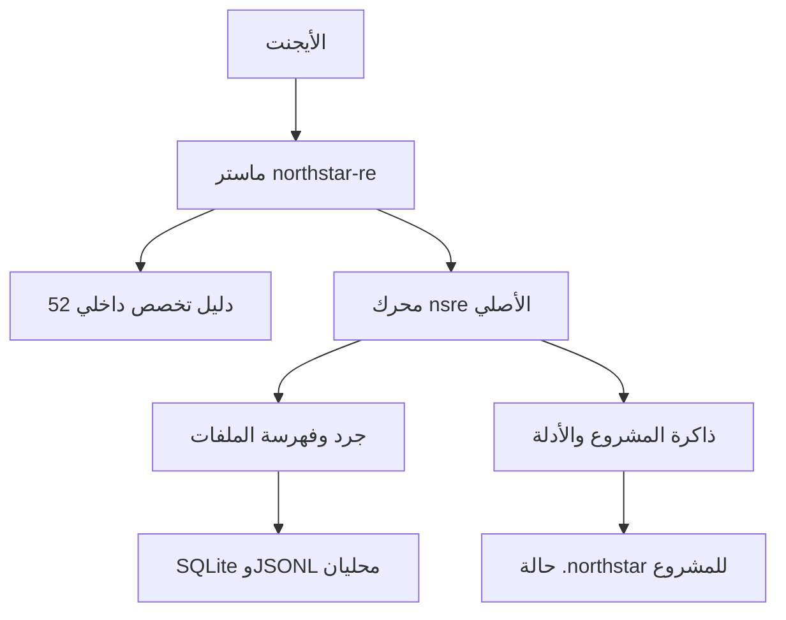

<picture>
  <source media="(prefers-color-scheme: dark)" srcset="assets/branding/banner-dark.svg">
  <source media="(prefers-color-scheme: light)" srcset="assets/branding/banner-light.svg">
  
</picture>

**[English](README.md)** · [التثبيت](INSTALL.md) · [تثبيت الأيجنت](INSTALL-FOR-AGENTS.md) · [التوثيق](docs/README.md) · [الإصدارات](https://github.com/AlMagrhibi/-NorthStar-RE-/releases)

**مرشح إصدار بحدود تحقق واضحة.** توجد ماستر واحدة و52 تخصصًا إرشاديًا و108 مدخلات أدوات ومراجع ومحرك Rust 0.3.0. نجح بناء Linux وWindows MSVC واختباراتهما وجميع بوابات CI ودورة المثبت وبناء السورس. قبول Windows 11 الفعلي وتكامل جميع الأيجنتات يظلان **UNVERIFIED** حتى إثباتهما. [تقرير القبول](docs/reports/ACCEPTANCE-AR.md).

## الفهرس

[المنتج](#نظرة-على-المنتج) · [الفلسفة](#فلسفة-المنظومة) · [القدرات](#القدرات-الرئيسية) · [المعمارية](#المعمارية) · [المحرك](#محرك-rust-الأصلي) · [الماستر](#المهارة-الماستر) · [التخصصات](#المهارات-التخصصية) · [الأيجنتات](#تكامل-الأيجنتات) · [المتطلبات](#متطلبات-windows-11) · [البداية](#البداية-السريعة) · [التثبيت](#التثبيت) · [التحديث](#الترقية) · [الأوامر](#مرجع-cli) · [الذاكرة](#ذاكرة-المشروع) · [العمل](#مسارات-العمل-الهندسية) · [المشاريع](#تعدد-المشاريع) · [الأداء](#الأداء-والتوسع) · [الأمان](#نموذج-الأمان) · [التوثيق](#التوثيق) · [الخارطة](#خارطة-التطوير) · [التنزيل](#تنزيل-الإصدارات)

## نظرة على المنتج

NorthStar RE Framework منظومة ذكاء هندسي للتحليل والتطوير واستمرارية المشاريع وفق الأدلة. يقرأ الأيجنت الماستر والتخصصات المناسبة، ثم يستدعي محركًا مركزيًا وأدوات موثقة داخل مشروع مصرح به. يتولى المحرك الجرد والتجزئة والفهرسة والحالة والبوابات، بينما ينفذ الأيجنت الاستدلال والعمل الهندسي.

## فلسفة المنظومة

اكتشف البيئة فعليًا، احفظ الأصول، وجّه العمل بالأدلة، وافصل الادعاء عن القياس. احفظ معرفة المشروع وتسليم الجلسة بعد المراجعة. تتكامل أدوات Windows وRust وC++ وC# وJava دون بديل تشغيل Python. V11 جيل المنظومة، وإصدار المحرك 0.3.0 مستقل عنه.

## القدرات الرئيسية

| الطبقة | المتاح | الحدود |
|---|---|---|
| محرك البيانات | scan وSHA-256 وفهرس SQLite وexport وdiff | cache المعتمد على metadata استرشادي |
| الفرز الثنائي | توقيع وإنتروبيا وتلميحات رأس PE | تحليل PE/CLR الكامل يحتاج أدوات خارجية موثقة |
| الحوكمة | مستندات وأدلة وبوابات وخطط ونقاط نسخ | المراجعة الدلالية والاستعادة صريحتان |
| الذاكرة | سجلات SQLite تراكمية وبحث نصي | لا بحث متجهي أو ترحيل قديم تلقائي |
| المعرفة | 52 تخصصًا هندسيًا | تعليمات وليست 52 محلل Rust |
| التكامل | تسجيل مهارة وAPI/MCP محلي تجريبي | المضيفون والتوافق الحقيقي غير متحققين |

## المعمارية

[المخططات وتدفق التنفيذ](docs/architecture/overview.md). يبقى Cargo في `skills/northstar-re/engine/nsre` للحفاظ على القوالب وعقود التثبيت، ويحتوي engine في الجذر على مختبر الأداء ودليل السورس.

## محرك Rust الأصلي

باينري بوحدات مستقلة يستخدم Rayon وwalkdir وSHA-256 وserde_json وSQLite. تعالج دفعات محدودة الملفات، وكاتب واحد يحدث الفهرس. تمنع الأخطاء والروابط المتخطاة اعتبار الجرد مكتملًا للأدلة. لا يوجد فك تشفير شامل أو SDK تنفيذي للإضافات أو موزع عمال. [دليل التطوير](docs/ar/development.md).

## المهارة الماستر

الهوية الثابتة **northstar-re**، والاستدعاء **`/skill:northstar-re`** محفوظ على المضيف الداعم. يسجل المثبت المسار المطلق للمحرك ويعلن ماستر واحدة. تتحول نسخ التخصصات المثبتة إلى GUIDE.md داخليًا مع تحديث التوجيه، وتبقى ملفات المصدر SKILL.md محفوظة.

## المهارات التخصصية

52 تخصصًا للتحليل المصرح والبيانات والملفات والكود الأصلي والمدار والخوادم والقواعد والشبكات وVisual Studio وRust وC++ وC# والأداء والتوثيق والجودة والأدلة. [التخصصات](docs/ar/specialists.md) · [السجل الآلي](schemas/specialists.json) · [كتالوج الأدوات](docs/ar/tools.md).

## تكامل الأيجنتات

توجد مسارات موثقة لـFreePi وCodex وPi وClaude والأيجنتات المتوافقة. **كل التكاملات الحية UNVERIFIED.** يستخدم Codex الأمر `$northstar-re` وClaude الأمر `/northstar-re`، وقد يستخدم Pi وFreePi الداعم `/skill:northstar-re`. [جدول التوافق والمصادر الرسمية](docs/en/compatibility.md).

## متطلبات Windows 11

Windows 11 x64 وأيجنت متوافق ومسارات مستخدم قابلة للكتابة. الحزمة التنفيذية لا تحتاج Rust أو Python. بناء السورس يحتاج Rust 1.91.1 MSVC وCargo وأدوات Visual Studio C++ وWindows SDK. لا تثبيت اعتماديات أو تنزيل شبكة أو تصعيد صلاحيات بصمت. [المتطلبات](docs/ar/getting-started.md).

## البداية السريعة

1. افتح [الإصدارات الرسمية](https://github.com/AlMagrhibi/-NorthStar-RE-/releases) بمصادقتك المعتمدة، واختر حزمة اجتازت التحقق واقرأ حدود المرشح.
2. تحقق من SHA256SUMS.txt وrelease-manifest.json وفك الحزمة كاملة.
3. أغلق الأيجنت وشغل `Install.cmd -Agent FreePi` أو اختر الأيجنت الحقيقي ومساره عبر -SkillRoot. بناء السورس قد يحتاج إذن تنزيل صريحًا -AllowDependencyDownload.
4. شغل Doctor.cmd وأعد تحميل الأيجنت وتحقق من اكتشاف الماستر واستدعائها بالطريقة الفعلية للمضيف.
5. استخدم مسار المحرك المسجل لتشغيل doctor ثم init وresume داخل مشروع موجود ومصرح به.

إن لم توجد حزمة Windows متحققة، اتبع بناء السورس أو سجل BLOCKED؛ لا تستخدم EXE مجهول المصدر. [التفاصيل](docs/ar/getting-started.md).

## التثبيت

المسار المركزي `%LOCALAPPDATA%\NorthStarRE\`. التثبيت للمستخدم وبملكية واضحة ونسخ احتياطية. يرفض المهارة غير المملوكة والمسارات المعاد توجيهها، ويحافظ على بيانات .northstar وإعدادات الأيجنت غير المرتبطة. [التثبيت](INSTALL.md) · [خطوات الأيجنت](INSTALL-FOR-AGENTS.md).

## الترقية

يستخدم Update.cmd الحزمة الموثقة التي حصلت عليها صراحة دون تنزيل صامت. يتحقق Fetch-Release.ps1 من إصدار متوافق بمصادقة GitHub وبصمته. إعادة نفس الحزمة تحقق آمن دون تثبيت مكرر. النسخ Backup.cmd والاستعادة Rollback.cmd بمسار نسخة صريح. يبقى المحرك المثبت يعمل محليًا عند انقطاع الإنترنت. [الترقية والإزالة](INSTALL.md).

## مرجع CLI

أوامر scan وindex وexport وdiff وprobe وanalyze؛ اكتشاف doctor وtools؛ تهيئة واستئناف وحالة وتقارير المشروع؛ أدلة وبوابات وذاكرة وجلسات ونقاط نسخ وخطط وقياس وAPI/MCP محلي للقراءة. استخدم مسارات مشاريع صريحة ومدخلات JSON مراجعة ومنقحة. [الأوامر](docs/ar/cli.md) · [الإعداد](docs/ar/configuration.md) · [الأخطاء](docs/ar/errors.md).

## ذاكرة المشروع

لكل مشروع .northstar/state/framework.sqlite ومستنداته وأدلته. تحفظ سجلات الجلسات والخطط والمعرفة تراكميا بعد المراجعة؛ تعيد القراءة أحدث 100 سجل كحد أقصى. تطابق SHA-256 لا يثبت صحة الاستنتاج. [الذاكرة والمخططات](docs/ar/memory.md).

## مسارات العمل الهندسية

اكتشاف البيئة ← النطاق والأصول ← التوجيه بالأدلة ← تنفيذ أدوات موثقة ← تأكيد النتائج ← التوثيق والبوابات والتسليم. تحفظ المكونات العاملة بـC++ وC# والملفات التنفيذية الأصلية. [مسارات العمل](docs/ar/workflows.md) · [حدود القدرات](docs/ar/capabilities.md).

## تعدد المشاريع

محرك مركزي واحد ومسارات مشاريع صريحة وحالة مستقلة، وقواعد الفهرسة خارج مصدر الملفات. لا تدخل المعرفة الخاصة في إصدار المنظومة. هذا فصل تنظيمي وليس حاجزًا ضد عملية أخرى بنفس صلاحيات النظام. [نموذج العزل](docs/ar/architecture.md).

## الأداء والتوسع

مختبر قابل لإعادة التنفيذ لسعات 1k و10k و100k و1M ملف اصطناعي، يقارن strict وmetadata reuse ويسجل الزمن وCPU وعينة الذاكرة وحجم القاعدة وإعادة الاستخدام ودقة النتائج. لا أرقام لسعات غير مقاسة أو ادعاءات Windows مستنتجة من Linux. [المختبر](docs/ar/performance.md) · [لوحة القياس](docs/reports/PERFORMANCE-AR.md).

## نموذج الأمان

فحص أهداف دون تنفيذها، نطاق مشروع صريح، قراءات محدودة، SQL بمعاملات، هوية قاعدة، تثبيت مملوك مرحلي ونسخ وتحديث صريح. يفحص CI الاعتماديات والتراخيص وأنماط أسرار مختارة وسلامة الحزمة. البصمات ليست توقيعًا ولا توجد شهادة أمان أو Authenticode. [السياسة](SECURITY.md) · [التقرير](docs/reports/SECURITY-AR.md) · [إشعارات الاعتماديات](THIRD-PARTY-NOTICES.md).

## التوثيق

[بوابة عربية وإنجليزية](docs/README.md) تشمل البداية والمعمارية والوحدات وCLI وAPI/MCP والذاكرة والمخططات والتطوير والتوافق والاختبارات والقياس والتوسعة والإصدارات. البحث والمراجع الأصلية محفوظة. [المساهمة](CONTRIBUTING.md) · [الدعم](SUPPORT.md).

## خارطة التطوير

المحلل المتقدم وبنية الإضافات وSDK والعمال الموزعون والجدولة التنفيذية وحاكم الموارد والبحث الآلي أهداف مخططة أو جزئية بوضوح. [سجل التنفيذ](ROADMAP.md) يربط كل مكون بالمصدر والدليل والحدود ومعيار القبول.

## تنزيل الإصدارات

**أحدث مرشح متحقق: [v11.0.0-rc.2](https://github.com/AlMagrhibi/-NorthStar-RE-/releases/tag/v11.0.0-rc.2).** [حزمة Windows](https://github.com/AlMagrhibi/-NorthStar-RE-/releases/download/v11.0.0-rc.2/NorthStar-RE-Framework-v11-Windows11-x64.zip) · [السورس](https://github.com/AlMagrhibi/-NorthStar-RE-/releases/download/v11.0.0-rc.2/NorthStar-RE-Framework-v11-Windows11-Source.zip) · [تقرير التسليم النهائي](docs/reports/FINAL-DELIVERY-AR.md).

[قائمة الإصدارات](https://github.com/AlMagrhibi/-NorthStar-RE-/releases) · [GitHub Actions](https://github.com/AlMagrhibi/-NorthStar-RE-/actions) · [هندسة النشر](RELEASE.md) · [سجل التغييرات](CHANGELOG.md).

الحزم المستهدفة بعد التحقق: ZIP للسورس وZIP لـWindows وباينري منفصل وبصمات وmanifest وSBOM وتقارير البناء والاختبارات والأمان. إعداد pipeline لا يثبت وجود إصدار منشور. المستودع خاص والمنظومة تحت حقوق المالك دون إضافة ترخيص مفتوح المصدر.
