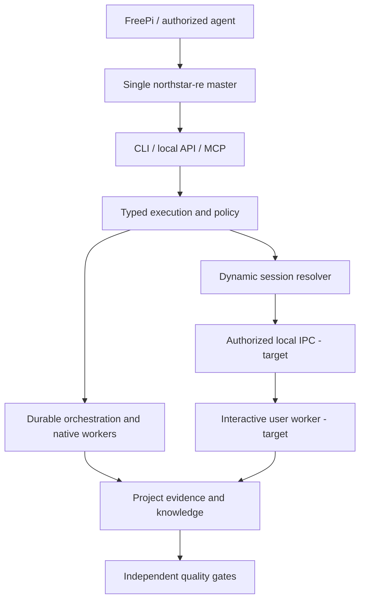

# NorthStar RE Framework

**Native Rust engineering intelligence for Windows 11 x64**

`0.012` · **Development / pre-production** · One master · Twelve engine domains

[العربية](README.ar.md) · [Architecture](docs/architecture/overview.md) · [Documentation](docs/README.md) · [Roadmap](ROADMAP.md) · [History](CHANGELOG.md) · [Versioning](docs/VERSIONING.md)

> **Status:** active engineering development, not a production release. 0.012 is the approved product display identity; the current development tree still declares `12.0.0-dev.1`. The SemVer migration to `0.0.12-dev.1` requires coordinated implementation and verification. The historical RC2 installation baseline remains unchanged.

## Purpose

NorthStar provides a project-scoped, evidence-driven execution layer for authorized engineering work. An AI coding agent selects specialist knowledge, invokes typed native operations, and consumes independently checked results. The framework separates reasoning, execution, interactive desktop access and assurance.

## Architecture

The architecture preserves 12 engine IDs, 52 internal specialist guides and 108 tool/reference entries. These counts describe the architecture and catalog, not 12 completed engines. Windows 11 x64/MSVC is the release target; the Rust core is `nsre.exe`. No Python runtime fallback.

## Current engineering baseline

Evidence snapshot: 2026-11-27, [`d917cb5`](https://github.com/AlMagrhibi/-NorthStar-RE-/commit/d917cb562e9248e9f5a924eda42e311899149acd), [PR #9](https://github.com/AlMagrhibi/-NorthStar-RE-/pull/9), [CI 45927809158](https://github.com/AlMagrhibi/-NorthStar-RE-/actions/runs/45927809158). Native, security and distribution checks passed; publication skipped. This is a dated snapshot, not a live status badge.

| Capability | Status at snapshot |
|---|---|
| Native inventory, index, local project state | Existing foundation |
| Twelve-engine registry and bounded offline operations | Candidate; all completion flags false |
| Durable queue, DAG and leases | Implemented foundation; fault and compatibility hardening remains |
| Windows process supervisor | Initial real-process tests; ownership, limits and crash recovery open |
| Dynamic Windows session/context discovery | Candidate; fail-closed guard and context reassessment |
| Interactive worker, authenticated IPC, reconnect | Target; not accepted |
| Adaptive input and independent UI effect verification | Target; additional work required |
| Development packaging | CI verified at snapshot; no publication authorized |
| Windows 11 / FreePi / SSH end-to-end | Not yet accepted |

Read the [engineering evidence matrix](docs/reports/TEST-EVIDENCE-MATRIX.json) and [implementation ledger](ROADMAP.md) for scope and limitations. Local reports are distinct from hosted Windows Server CI.

## Installation and evaluation

[Historical RC2 installation](INSTALL.md) · [Agent installation](INSTALL-FOR-AGENTS.md) · [Release engineering](RELEASE.md). These guides retain their historical baseline until the version migration is completed. Use only verified development artifacts in a disposable profile; do not overwrite the stable baseline or assume development artifacts are official releases.

## Engineering governance

The [unified execution directive](docs/NORTHSTAR-V12-EXECUTION-DIRECTIVE.md) preserves all 42 approved additions and NSO/DSC/WISM/T01–42 gates. Its legacy filename is retained for traceability. Authorized work only; project isolation, least privilege, no bypass of locked or unauthorized Windows sessions, no secret disclosure, no automatic replay of uncertain effects.

[Security](SECURITY.md) · [Contribution](CONTRIBUTING.md) · [Development guide](docs/en/development.md) · [CLI reference](docs/en/cli.md) · [Specialists](docs/en/specialists.md) · [Tool catalog](docs/en/tools.md)

## History

The project is early-stage. Historical V-series labels identify internal engineering iterations and the preserved RC2 artifact, not twelve independently accepted production generations. See [version policy](docs/VERSIONING.md) and [changelog](CHANGELOG.md). The full pre-reorganization README remains available in the [immutable Git snapshot](https://github.com/AlMagrhibi/-NorthStar-RE-/blob/d917cb562e9248e9f5a924eda42e311899149acd/README.md).
