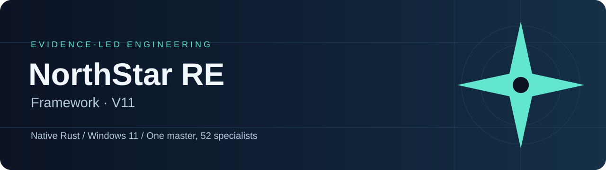
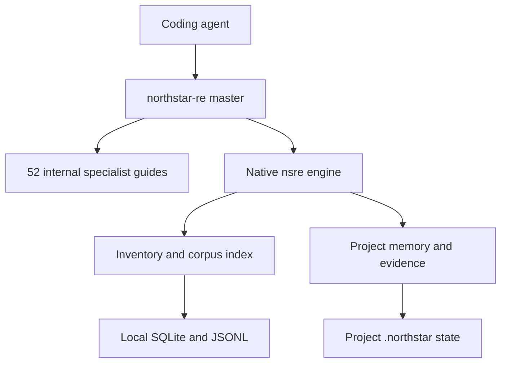

<picture>
  <source media="(prefers-color-scheme: dark)" srcset="assets/branding/banner-dark.svg">
  <source media="(prefers-color-scheme: light)" srcset="assets/branding/banner-light.svg">
  
</picture>

**[العربية الكاملة](README.ar.md)** · [Install](INSTALL.md) · [Agent installation](INSTALL-FOR-AGENTS.md) · [Documentation](docs/README.md) · [Releases](https://github.com/AlMagrhibi/-NorthStar-RE-/releases)

**Release candidate, with explicit verification boundaries.** The source contains one master, 52 specialist instruction modules, 108 tool/reference entries and the native Rust engine 0.3.0. Linux and Windows MSVC builds, mandatory CI, executable checks and the full installer/source-build lifecycle are verified. Real Windows 11 desktop and all coding-agent integrations remain **UNVERIFIED** until observed. [Acceptance evidence](docs/reports/ACCEPTANCE-AR.md).

## Contents

[Overview](#product-overview) · [Philosophy](#framework-philosophy) · [Capabilities](#key-capabilities) · [Architecture](#architecture-overview) · [Engine](#native-rust-engine) · [Master](#master-skill) · [Specialists](#specialist-skills) · [Agents](#supported-agent-integration) · [Requirements](#windows-11-requirements) · [Quick start](#quick-start) · [Installation](#installation) · [Upgrade](#upgrade) · [CLI](#cli-reference) · [Memory](#project-memory) · [Workflows](#engineering-workflows) · [Projects](#multi-project-support) · [Performance](#performance-and-scalability) · [Security](#security-model) · [Docs](#documentation) · [Roadmap](#roadmap) · [Downloads](#release-downloads)

## Product overview

NorthStar RE Framework is an engineering intelligence framework for evidence-led analysis, development and project continuity. A coding agent uses the master to select relevant specialist knowledge, then invokes a shared native engine and independently verified tools in an authorized project. The engine handles inventory, hashing, indexing, state and quality evidence; the agent performs reasoning and tool-guided engineering.

## Framework philosophy

Discover the actual environment. Preserve originals. Route from evidence. Keep claims distinct from measurements. Maintain local project knowledge and a reviewed handoff. Windows, Rust, C++, C# and Java tools work together; no interpreter fallback silently changes the execution path. Generation V11 describes the framework; engine 0.3.0 is a separate crate version.

## Key capabilities

| Layer | Available behavior | Boundary |
|---|---|---|
| Native data engine | SHA-256 scan, SQLite index, export and strict diff | Metadata cache is advisory |
| Binary triage | Bounded signature, entropy and PE-header hints | Full PE/CLR analysis uses external verified tools |
| Governance | Documentation, evidence, gates, plans, checkpoints | Semantic review and restore are explicit |
| Project memory | Local append-only SQLite records and text search | No vector retrieval or automatic legacy migration |
| Specialist knowledge | 52 analysis/development/governance modules | Instructions, not 52 native analyzers |
| Integration | Agent skill installation; local API/MCP candidate | Actual hosts and MCP interoperability unverified |

## Architecture overview

[Architecture and execution flow](docs/architecture/overview.md). The authoritative workspace stays at `skills/northstar-re/engine/nsre` to preserve template and installer paths. The root `engine/` directory contains the performance lab and source-location guide.

## Native Rust engine

A modular binary built with Rayon, walkdir, SHA-256, serde_json and SQLite. Bounded batches feed one index writer. Outputs carry completion states; errors and skipped links prevent evidence-grade completeness. There is no bundled decryptor, worker scheduler, compiled plugin SDK or distributed service. [Source and build guide](docs/en/development.md).

## Master skill

Stable identity: **northstar-re**. The established invocation **`/skill:northstar-re`** is preserved on supporting hosts. The installer records the absolute engine path and registers one discoverable master. It keeps specialist content as internal `GUIDE.md` files in installed copies, while preserving source `SKILL.md` modules and routing compatibility.

## Specialist skills

52 modules cover authorized reverse engineering, files/data, native and managed analysis, account/game servers, databases/networks, Visual Studio, Rust/C++/C#, performance, documentation, continuity, evidence and quality. [Complete catalog](docs/en/specialists.md) · [Machine-readable registry](schemas/specialists.json) · [108-entry tool catalog](docs/en/tools.md).

## Supported agent integration

FreePi, Codex, Pi Coding Agent, Claude Code and compatible skill hosts have documented installation routes. **All live integrations are UNVERIFIED.** Paths, invocation and reload differ: Codex uses `$northstar-re`, Claude `/northstar-re`, and Pi/compatible FreePi hosts may use `/skill:northstar-re`. [Compatibility matrix and official references](docs/en/compatibility.md).

## Windows 11 requirements

Windows 11 x64, a compatible agent and writable per-user directories. Binary packages need no Rust or Python runtime. Source installation requires pinned Rust 1.91.1 MSVC, Cargo, Visual Studio C++ Build Tools and Windows SDK. PowerShell manages installation; prerequisites and network downloads are never installed/approved silently. [Requirements](docs/en/getting-started.md).

## Quick start

1. Open [official Releases](https://github.com/AlMagrhibi/-NorthStar-RE-/releases) using authorized private-repository access. Choose a successfully verified V11 package; read candidate limitations.
2. Verify `SHA256SUMS.txt` and `release-manifest.json`, then extract the whole package.
3. Close the agent and run `Install.cmd -Agent FreePi` (or the actual supported agent / explicit `-SkillRoot`). Source builds may need explicitly authorized `-AllowDependencyDownload`.
4. Run `Doctor.cmd`, reload the agent and verify the master using the host's actual invocation syntax.
5. In an approved existing project, run the recorded engine path with `doctor`, `init --project DIR` and `resume --project DIR`.

If no verified Windows asset exists, use the documented source build or report **BLOCKED**. Never substitute an unknown executable. [Detailed quick start](docs/en/getting-started.md).

## Installation

Per-user central root: `%LOCALAPPDATA%\NorthStarRE\`. Owned skills are staged and backed up. Unowned skills and redirected paths are refused. Project `.northstar` data and unrelated agent settings are preserved. [Install](INSTALL.md) · [Agent-first procedure](INSTALL-FOR-AGENTS.md).

## Upgrade

`Update.cmd` installs an explicitly acquired verified package; it does not silently fetch updates. `Fetch-Release.ps1` supports authenticated, compatible release discovery and checksum verification. Matching packages are idempotent. Use `Backup.cmd` and `Rollback.cmd -BackupPath ...` for controlled recovery. Installed local functions remain usable offline. [Upgrade and removal](INSTALL.md).

## CLI reference

`scan`, `index`, `export`, `diff`, `probe`, `analyze`; `doctor`, `tools`; project `init`, `resume`, `status`, `report`, documentation/evidence/gates, session/memory/search, checkpoints, plans, benchmark and read-only stdio API/MCP. Use explicit project roots and reviewed redacted input JSON. [Complete command contracts](docs/en/cli.md) · [Configuration](docs/en/configuration.md) · [Errors](docs/en/errors.md).

## Project memory

Each project owns `.northstar/state/framework.sqlite`, docs, evidence and checkpoints. Session, plan and knowledge records are appended after review. SHA-256 matches bytes; findings still require provenance and reasoning. Reads return at most 100 newest records. [Memory and schema reference](docs/en/memory.md).

## Engineering workflows

Environment discovery → approved scope and originals → evidence-based routing → native/verified tool execution → corroboration → documentation, quality gates and handoff. Original C++/C# components and original launchers are preserved. [Engineering workflows](docs/en/workflows.md) · [Capability boundaries](docs/en/capabilities.md).

## Multi-project support

One central engine, explicit project roots, independent state. Index databases stay outside their corpus; project knowledge is never folded into framework releases. This is organizational separation, not a hostile multi-tenant OS sandbox. [Isolation model](docs/en/architecture.md).

## Performance and scalability

A reproducible lab covers 1k/10k/100k/1M synthetic files, strict versus metadata reuse, wall/CPU time, sampled memory, DB size, cache reuse and output accuracy. Published measurements apply only to their recorded environment. No unmeasured capacity or Windows throughput is claimed. [Lab](docs/en/performance.md) · [Measured dashboard](docs/reports/PERFORMANCE-AR.md).

## Security model

Read-only target inspection, explicit project scope, bounded reads, SQL parameters, DB identity checks, owned staged installation, backups and explicit updates. CI audits locked dependencies, declared licenses, selected secret patterns and package integrity. Checksums are not signatures; no Authenticode signing or security certification is claimed. [Security policy](SECURITY.md) · [Security report](docs/reports/SECURITY-AR.md) · [Third-party notices](THIRD-PARTY-NOTICES.md).

## Documentation

[English / Arabic portal](docs/README.md): getting started, first run, architecture, modules, CLI, API/MCP, memory/schema, engineering, configuration, compatibility, testing, benchmarks, extensions and release engineering. Research and technical references from the source package are retained. [Contributing](CONTRIBUTING.md) · [Support](SUPPORT.md).

## Roadmap

Advanced parsers, plugin architecture, adapter SDK, distributed workers, executable scheduler, resource governance and automated research are explicitly planned or partial. [Implementation ledger](ROADMAP.md) records source, evidence, limitations and acceptance criteria for every component.

## Release downloads

**Latest verified candidate: [v11.0.0-rc.2](https://github.com/AlMagrhibi/-NorthStar-RE-/releases/tag/v11.0.0-rc.2).** [Windows x64 ZIP](https://github.com/AlMagrhibi/-NorthStar-RE-/releases/download/v11.0.0-rc.2/NorthStar-RE-Framework-v11-Windows11-x64.zip) · [Source ZIP](https://github.com/AlMagrhibi/-NorthStar-RE-/releases/download/v11.0.0-rc.2/NorthStar-RE-Framework-v11-Windows11-Source.zip) · [Final verification report](docs/reports/FINAL-DELIVERY-AR.md).

[Official release list](https://github.com/AlMagrhibi/-NorthStar-RE-/releases) · [GitHub Actions](https://github.com/AlMagrhibi/-NorthStar-RE-/actions) · [Release process](RELEASE.md) · [Changelog](CHANGELOG.md).

Expected verified artifacts: source ZIP, Windows x64 ZIP, standalone `nsre-windows-x64.exe`, checksums, release manifest, CycloneDX SBOM and build/test/security evidence. A configured pipeline is not a published release. The framework remains private and owner-controlled; no open-source license has been added.
