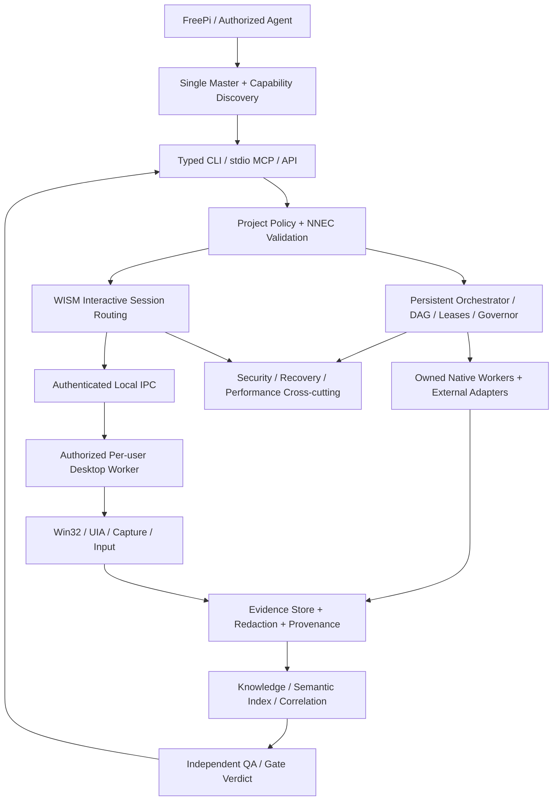

# V12 adoption

The owner adopts the complete directive below for generation V12. References to V11 describe the inherited baseline; all 42 ADD requirements and all acceptance gates remain mandatory. This adoption does not rename the twelve engine IDs, change existing schemas or certify completion. RC2 remains the historical installation baseline until the unified candidate meets release gates.

# NORTHSTAR RE FRAMEWORK V11
## Unified Engineering Execution Directive — Native Rust / Windows 11 / FreePi / SSH

**الوثيقة:** NS-V11-UED-001 · Revision 1.0 · 2026-11-26  
**المالك:** نطاق التطوير المعتمد في المحادثة · **حالة التنفيذ:** متطلبات معتمدة، وليست شهادة اكتمال  
**الأولوية:** P0 Release Blocker · **المنصة:** Windows 11 x64 · **المستودع:** [NorthStar RE Framework](https://github.com/AlMagrhibi/-NorthStar-RE-)  
**المرجع الأساسي:** `NORTHSTAR-RE-V11-MASTER-HANDOVER.md` · **المرجع التشغيلي:** تقارير FreePi أثناء تنفيذ مشروع NS_CO_RE  
**الهدف:** إصدار V11 موحد، قابل للتثبيت والاستعادة، مثبت بالأدلة، ينقل العمل التنفيذي المتكرر من النموذج إلى المحركات الأصلية.

> **إلى الأيجنت المطوّر:** اقرأ الوثيقة كاملة ثم نفّذها، وليس مجرد تلخيصها أو اقتراح خطة أخرى. هذه الوثيقة تجمع 42 متطلبًا معتمدًا وتدمج التكليف السابق WISM/SSH مع نتائج الاختبار الفعلي واحتياجات الأيجنت. حافظ على العمل السليم الجاري في المستودع وعلى المعمارية المعتمدة. لا تبدأ المشروع من الصفر، ولا تحول أسماء المتطلبات إلى محركات أو Skills جديدة، ولا تدّعِ نجاحًا لا تدعمه الأدلة. لا تنتظر موافقة مكررة على النطاق المعتمد؛ اطلب فقط تدخلًا لا يمكن تنفيذه من البيئة المتاحة، أو قرارًا جديدًا خارج النطاق.

---

## 0. طريقة استخدام الوثيقة ومصادرها

### 0.1 مصادر المتطلبات

| المصدر | المحتوى المتاح | كيفية الاعتماد |
|---|---|---|
| S1 — Master Handover | الملف الكامل، 434 سطرًا؛ المعمارية والـ12 محركًا، NSO/DSC، RC2، سياق التشغيل | مرجع تاريخي؛ أعد التحقق من HEAD والأدلة الحية |
| S2 — مراجعة GitHub في المحادثة | PR #9 عند `37c133eac0305b8b77a3a946ec916d636bcb78f9`، نتائج CI وregistry وتقارير التطوير | آخر مراجعة معروفة، لا تفترض أنها الحالة الحالية |
| S3 — تكليف WISM/SSH السابق | 20 بوابة WISM، دعم Local/SSH، دورة حياة العامل والمهام، Desktop Control | يُدمج دون تكرار أو إسقاط |
| S4 — سجل الأيجنت أثناء G04/G05 | Session 0/1، أخطاء الإدخال، حالة التطبيق، التحقق المحلي، الخوادم، الشبكة، 503 | ملاحظات أبلغ عنها الأيجنت؛ الأدلة الأصلية على الجهاز المحلي |
| S5 — `docs/FRAMEWORK-ENGINES-PROPOSAL.md` | الملخص المرسل من المستخدم: E01–E10، أولويات 1–3 | لم يُتح الملف الكامل في هذه المحادثة؛ استخرجنا كل ما ورد في الملخص |
| S6 — `docs/NORTHSTAR-V11-AGENT-ENGINEERING-FEEDBACK.md` | الملخص المرسل: C01–C12، P0/P1، ثلاث رسائل هندسية رئيسية | لم يُتح الملف الكامل في هذه المحادثة؛ راجعه من المشروع المحلي إذا أتيح بطريقة مصرح بها |
| S7 — اعتمادات المالك | ADD-001–042 وجميع التوسعات التي نوقشت | نطاق التطوير معتمد؛ لا يعني أن كل وظيفة منفذة |

لا تنقل ملفات CO/SOR أو لقطات المستخدم أو السجلات الخام أو بيانات الاعتماد إلى المستودع العام. لا تستبدل محتوى التقارير المحلية أو تخترع حقولها غير المتاحة. عندما تتوفر S5/S6 كاملتين، أضف traceability delta لما لم يظهر في الملخصين؛ لا تعد تنفيذ المتطلبات المعتمدة ولا تقلّصها بصمت.

### 0.2 خط أساس GitHub الواجب تحديثه أولًا

آخر فحص موثق في المحادثة (وليس استعلامًا حيًا عند تأليف هذه الوثيقة):

- [PR #9](https://github.com/AlMagrhibi/-NorthStar-RE-/pull/9): open/draft/not merged، branch `engineering/engine-orchestrator-foundation`، 58 commits و93 ملفًا متغيرًا عند الفحص؛ base `66d09cd6fb7f496734d9ea672f254452497ece75`.
- مقارنةً بملف Handover عند `87f1b97771c9273e2dce26550bd7126c28756d39`: 11 commits إضافية. عائق PowerShell القديم تم إصلاحه؛ لا تكرر إصلاحه إلا إذا عاد بالدليل.
- [CI 45880533618](https://github.com/AlMagrhibi/-NorthStar-RE-/actions/runs/45880533618): 46 اختبار Rust ناجحًا في دورة واحدة، Security/License وmanifest/integrity PASS، Native job FAIL عند `Desktop command failed: capture-wgc`، Package/Publish skipped. السبب الجذري الدقيق لـWGC لم يُثبت في السجل المتاح.
- [CI 45878989928](https://github.com/AlMagrhibi/-NorthStar-RE-/actions/runs/45878989928): Native/Security/Verified Windows distributions PASS، Publish skipped (PR).
- [CI 45878056470](https://github.com/AlMagrhibi/-NorthStar-RE-/actions/runs/45878056470): تقرير المستودع يوثق نجاح fixture Windows Server 2022 للكتابة والنقر وUIA وأثر التطبيق، وتصوير نافذة مغطاة عبر PrintWindow، واستعادة/تحريك/تغيير حجم النوافذ. ليس اختبار Windows 11 الفعلي.
- registry يحتوي 12 محركًا، وكل `complete=false` عند آخر HEAD المفحوص. وجود routes لا يعني اكتمال المحركات. 23 أمرًا Desktop مسجلًا عند ذلك الفحص.
- Queue schema v2، cross-job dependencies، حجز تعاوني للموارد، local collectors، bounded PE layout، governed batch عبر Job Objects، واجهة desktop typed/stdio موجودة بدرجات تحقق مختلفة. leases/reconciliation/running cancellation والقبول المحلي مع FreePi لم تكن مغلقة.
- `v11.0.0-rc.2` هو baseline التثبيت التاريخي وrelease-request كان ما زال يشير إليه. لا تستخدم tag قديمًا لنسخة جديدة. تحقق من الإصدارات الفعلية قبل أي تغيير.

**أول خطوة تنفيذية:** اجلب HEAD/base/ref/PR/CI/release status والسورس الفعلي. افحص الملفات والأدلة التالية، ثم اعمل جدول `existing / partial / missing / verified / blocked` لكل متطلب. لا تجعل هذا الجدول بديلًا عن التنفيذ.

- `skills/northstar-re/engine/nsre/src/{main,framework,rpc,queue,batch,collect,lab,probe,pe,governor,desktop,desktop_api}.rs` حسب وجودها الفعلي.
- `skills/northstar-re/engine/nsre/src/desktop/`، `engine-registry.json`، `SKILL.md`، `adapters/README.md`.
- `docs/architecture/` و`docs/reports/`، `scripts/Test-Orchestrator-Windows.ps1` و`Test-Desktop-Windows.ps1` و`Run-Native-Checks.ps1` و`Validate-Package.ps1`، installer/release workflows.
- لا تفترض أن `SOR/Tools/NorthStarRECore/nsre-intel` في مشروع المستخدم هو نفس workspace العام. ادمج الأنماط العامة بعد فحص عقودها وترخيصها؛ لا تستورد مشروع المستخدم أو كوده الخاص إلى GitHub تلقائيًا.

## 1. قرارات معمارية ملزمة (Design Invariants)

1. الهوية: NorthStar RE Framework V11 — Native Rust Intelligence Engine؛ Windows 11 x64/MSVC هو الهدف الوحيد للإصدار. لا Linux/WSL/Python كمتطلبات تشغيل أو بدائل قبول؛ الاختبارات المحلية غير Windows أدلة تكميلية فقط.
2. Single Master `northstar-re`، 12 محركًا بأسمائها ومعرّفاتها الحالية، مع مراجع داخلية متخصصة. لا 12 جلسة نماذج أو Skills مستقلة، ولا محرك ثالث عشر. أسماء WISM/NNEC/Adaptive Input وغيرها هي capability groups داخل المحركات.
3. Rust First؛ PowerShell 7 للتثبيت والاختبارات وأدوات الإدارة المصرح بها، وGhidra/Java وVS/C++/C# أدوات خارجية متخصصة عبر adapters محكومة. لا Python runtime/fallback ولا scripts مؤقتة يعيد النموذج اختراعها في كل مهمة.
4. Local-first / project-scoped / evidence-driven / agent-agnostic. FreePi هو مضيف القبول الأساسي، وCLI/MCP/API عقود موحدة قابلة للاكتشاف. التنفيذ المحلي لا يستدعي نموذجًا لكل محرك؛ تفسير النتائج قد يستهلك tokens.
5. استخدم workspace واحد authoritative؛ حافظ على registry والعمليات الحالية، ونسخة schema وCLI compatibility أو migration صريحة مع rollback. لا تغير المسارات أو التبعيات أو الإصدارات الموثوقة دون توثيق السبب.
6. Least privilege؛ الملكية المصرح بها لجهاز المستخدم وموارد المشروع ليست تفويضًا لتجاوز حدود Windows أو جمع أسرار أو الوصول لخدمات أطراف أخرى. المكوّن التفاعلي يعمل ضمن الجلسة التي أجازها المستخدم، لا يتجاوز القفل/UAC/secure desktop أو سياسات التطبيق. لا remote listener جديد أو shell عشوائي عبر GUI bridge.
7. Original client evidence لا يساوي TestClient evidence؛ قياسات الأداء لا تساوي ادعاءات تحسين؛ نجاح CI لا يساوي نجاح Windows 11 أو FreePi؛ نجاح dispatch لا يساوي اكتمال المحرك.
8. الأولوية استكمال المحركات والـOrchestrator، وDesktop Control/WISM ضمن Runtime؛ إصلاح CI مبكرًا ومعالجة التبعيات المتداخلة دون تجميد الفرق. جميع البوابات السابقة والجديدة لازمة للتسليم الموحد. لا إصدار ناقص، لا تحديث FreePi قبل القبول والترقية/rollback.

## 2. خريطة الاحتكاكات الفعلية (Incident Register)

هذه الحالات reported من تنفيذ FreePi، لا تُعد إعادة اختبار من مؤلف الوثيقة. استخدمها لتصميم fixtures عامة قابلة للتكرار.

| Incident | الملاحظة | المتطلب الناتج |
|---|---|---|
| INC-01 | Agent و`play.exe` في Session 0 عبر SSH، سطح المستخدم في Session 1؛ دقة 1024×768 مقابل 2560×1440؛ توقف التحكم نحو ساعة حسب الأيجنت | WISM/SSH worker discovery؛ لا hardcode للجلسة |
| INC-02 | أخطاء Windows API 24 و1314، Scheduled Task مؤقت نجح في probe: SESSION=1/CURSOR_MOVE/CAPTURE | worker مصرح به + IPC/identity/lifecycle بدل workaround مرتجل |
| INC-03 | `ENGINE_TIMEOUT` بعد 120s؛ Ghidra job 900s عالق عند `Press any key` | deadlines، progress، heartbeat، prompt/hang detection |
| INC-04 | SendKeys وUnicode لا يصلان إلى اللعبة، scan codes نجحت؛ mapping N→M؛ الحافظة لم يثبت نجاحها منفردة | adaptive input + layout + effect verification |
| INC-05 | Modal dialog لم يغلق، الحقول بقيت فارغة؛ العميل في loading فترة؛ لقطات متكررة | state machine/readiness/modal awareness، vision regions/cache |
| INC-06 | ظهور `Wrong password` أعقبه افتراض خارجي ثم فحص شبكة؛ أبلغ الأيجنت عن dialog طول 10–14 حرفًا ورفض محلي قبل SYN؛ كلمة الاختبار كانت 36 حرفًا | input contract validation، hypothesis/evidence separation، network/visual correlation |
| INC-07 | AS/GS توقفا بصمت؛ stdin والازدواج في المنفذ وسباق migrations؛ تم تشغيلهما مؤقتًا بأنبوب shell | native process supervisor / startup DAG / ownership / I/O |
| INC-08 | رصد استطلاع HTTP على loopback :80 وطلب version.dat، والاستدلال من pktmon/netstat يدويًا | bounded local network observation وcorrelation؛ ليس دليل مصادقة |
| INC-09 | 3 إخفاقات تجميع Ghidra FindServerDat حسب التقرير | typed headless adapter وscript preflight |
| INC-10 | 6+ قراءات رؤية متكررة حسب الأيجنت؛ 19m03s / 29 tool calls / Thought×20 في عينة واحدة | telemetry/baseline/caching؛ لا تعمم الزمن على الجلسة كلها |
| INC-11 | `HTTP 503` وإعادة تشغيل FreePi أثناء العمل | reconnect/resume/reconcile دون تكرار side effects |
| INC-12 | الحاجة إلى تقنيع سجل المستجيب؛ إعادة تعيين حساب اختبار بنقل hash من حساب مؤقت | redaction/vault، واجهة رسمية لإدارة حساب اختبار بدل التلاعب المباشر بالـhash |
| INC-13 | ظهور `Logging into account server...` بعد الإدخال الصحيح حسب التقرير؛ استنتاجات غير مثبتة عن Server.dat وعنوان الخادم | evidence correlation/compatibility؛ لا اعتبار النص إثبات وصول مصادقة |
| INC-14 | طلب الأيجنت crypto lab أصلي سريع، وذكر نمط three_way ونتيجة بحث PS لم تكتمل | generic native crypto validation، known-answer/reference fixtures وقياس الأداء؛ لا تبنِ على استنتاج خوارزمية/بذرة غير مثبت |

حالة المشروع التطبيقية reported: G04 تشغيل العميل الأصلي وشاشة TwinCity والتفاعل؛ G05 تجاوز تحقق مدخلات محلي فقط، الاتصال بخادم المصادقة الخاص غير مثبت؛ G06 دخول العالم غير مثبت. لا تجعل تعديل تطبيق CO أو إكمال G05/G06 ضمن تكليف المستودع العام؛ استخدم تطبيقات/خدمات اصطناعية مملوكة للفريمورك لإثبات عمومية القدرات.

## 3. Target Architecture — تصميم طبقات موحد



### 3.1 الفصل بين الطبقات

| Plane | المسؤولية | الحدود |
|---|---|---|
| Control | discovery, typed submit/status/wait/cancel, evidence retrieval, explicit GUI operation | لا arbitrary shell/network endpoints؛ validate schema وscope قبل التنفيذ |
| Execution | Rust workers، bounded collectors، Ghidra adapter، synthetic test services | Job Object/quotas على العمليات المملوكة؛ لا قتل عمليات المستخدم الأخرى |
| Interactive | Worker مصرح به لكل جلسة مستخدم، IPC محلي، GUI serialized | لا تنفيذ GUI تلقائيًا من background queue؛ لا تجاوز UAC/lock، لا input على نافذة خاطئة |
| Data | SQLite state per project، artifacts immutable/atomic، cache/index | منع cross-project access وpath traversal؛ لا أسرار خام في DB أو reports |
| Assurance | مستقل عن producer؛ rehash/replay/positive/negative/fault checks | fail closed عند نقص دليل لازم؛ لا self-certified PASS |

### 3.2 حدود المكونات (اقتراح تصميم يعتمد بعد مطابقة السورس)

أعد استخدام modules القائمة مثل `queue.rs`, `governor.rs`, `collect.rs`, `desktop/*`, `desktop_api.rs`, `rpc.rs`, `pe.rs`. اقترح modules داخل workspace نفسه لعقود execution/evidence/policy، supervision، session/IPC، input layout/state، network observations، external adapters، vault، telemetry وcorrelation. أسماء الملفات الداخلية ليست أوامر موجودة ولا شرطًا لإنشاء ملفات مكررة؛ سجّل ADR عند اختيار الحدود الفعلية، مع dependency direction وtest strategy. استعمل traits صغيرة versioned، typed enums/errors وbounded I/O؛ لا cyclic dependencies بين المحركات، ولا duplicate source of truth.

### 3.3 توزيع المحركات الـ12 والإغلاق الخاص بكل محرك

| Engine ID | مسؤولية التطوير والإغلاق |
|---|---|
| `native-core` | NNEC، execution/IPC lifecycle، API contracts، file collectors، typed adapters، registry؛ validation/error invariants وbackward compatibility |
| `binary-intelligence` | bounded PE32/PE32+، imports/exports/sections وفق نطاق موثق، Ghidra batch/adapter، parse malformed/large inputs، normalized outputs؛ لا ادعاء full loader validation |
| `semantic-intelligence` | import/export function/relationship graphs مع provenance، incremental indexing، state/semantic relationships؛ لا ادعاء extraction من graph مقدم فقط |
| `algorithm-intelligence` | catalog/classification بثقة، native Rust generic crypto/algorithm lab، known-answer vectors وnegative cases وbenchmarks؛ لا افتراض خوارزمية أو استهداف حماية تطبيق بعينه |
| `data-engineering` | versioned format adapters، lossless roundtrip، bounded large/malformed inputs، safe schema migration وtest account lifecycle interfaces |
| `runtime-diagnostics` | process/session intelligence، WISM، Desktop Control، adaptive input، app readiness/state، local vision، network observations، supervised process health |
| `compatibility` | versioned protocol/schema contracts، owned local test harness، input contracts، synthetic interoperable fixtures، transport vs app error separation |
| `security` | policy، vault، redaction، IPC identity/access control، negative/regression/isolation، dependency/license gates |
| `performance` | actual CPU/RAM/IO measurements، Job Objects، timings/telemetry/baselines، bounded cache/invalidation، realistic load tests |
| `knowledge` | project memory/index، provenance/manifest، evidence retrieval and correlation، stale data detection |
| `recovery` | queue leases/reconciliation، retry policy، controlled restart، checkpoint/restore verification، cancellation/fault injection، no duplicate GUI effects |
| `quality-assurance` | independent verdicts، traceability، fixtures، evidence validation، original vs synthetic distinction، release gates |

كل محرك له owner واضح وعقد عمليات واختبارات مستقلة، ثم cross-engine integration. لا تغيّر `complete` إلى true بناء على row في الجدول أو fixture واحدة.

## 4. NNEC — NorthStar Native Execution Contract (عقد إلزامي)

### 4.1 Typed execution request

صمّم schema versioned موحدًا أو extension متوافقًا للعقود الموجودة. المثال التالي تصميم مقترح، وليس CLI متاحًا الآن. تجنب embedding للأسرار أو نصوص shell. استخدم references لا raw secret values.

```json
{
  "schema": 1,
  "execution_id": "uuid",
  "project_id": "project-local-id",
  "engine_id": "runtime-diagnostics",
  "operation": "typed-operation-id",
  "capability_version": 1,
  "target_ref": "validated-project-target",
  "input_ref": "project-relative-manifest",
  "input_sha256": "sha256-of-canonical-input-bytes",
  "dependencies": [],
  "exclusive_resources": [],
  "priority": 50,
  "deadline_ms": 120000,
  "budget": {"workers": 1, "memory_mib": 256, "cpu_percent": 25},
  "idempotency": "read-only|safe-repeat|effectful-no-auto-replay",
  "authorization_ref": "local-policy-decision-id"
}
```

### 4.2 Typed execution result

```json
{
  "schema": 1,
  "execution_id": "uuid",
  "attempt_id": "uuid",
  "project_id": "project-local-id",
  "engine_id": "engine-id",
  "operation": "operation-id",
  "producer_version": "actual-version",
  "commit_sha": "actual-build-commit",
  "state": "completed",
  "verification": "unverified",
  "started_at_utc": "actual-utc-timestamp",
  "finished_at_utc": "actual-utc-timestamp",
  "duration_ms": 0,
  "exit_code": 0,
  "progress": {"stage": "terminal", "completed_units": null, "total_units": null},
  "input_sha256": "actual-digest",
  "result_sha256": "actual-digest-of-result-artifact",
  "error": null,
  "evidence_refs": [],
  "resource_usage": {"measured_by_engine": false},
  "recovery": {"status": "not-needed"},
  "limitations": []
}
```

حقول hashes هنا placeholders للتصميم فقط؛ لا تنتجها باعتبارها نتائج حقيقية. لا تحسب نتيجة JSON ذاتيًا بداخلها؛ افصل digest envelope أو artifact manifest وحدد canonicalization/version. Signed timestamp في اقتراح الأيجنت يُترجم أولًا إلى UTC+monotonic durations وسجل provenance قابل للتحقق؛ timestamp أو SHA-256 ليس توقيع ناشر أو دليل عدم العبث بمفرده. إذا احتجت توقيعًا حقيقيًا فوثق trust/key management وverification منفصلًا، ولا تخترع توقيعًا.

### 4.3 State machine and error taxonomy

- States: QUEUED, RUNNING, COMPLETED, FAILED, CANCELLED, INTERRUPTED, TIMED_OUT, BLOCKED, UNVERIFIED (أو mapping منفصل لـverification status دون خلطه بحالة lifecycle).
- Verification: PASS / FAIL / UNVERIFIED / BLOCKED / UNSUPPORTED / NOT_APPLICABLE (الأخيرة تحتاج سببًا موثقًا، لا تستخدمها لإسقاط gate إلزامي).
- Error classes: INVALID_INPUT, POLICY_DENIED, SESSION_UNAVAILABLE, TARGET_CHANGED, UNSUPPORTED_CAPABILITY, TOOL_MISSING, SPAWN_FAILED, PORT_CONFLICT, NOT_READY, INTERACTIVE_PROMPT, NO_PROGRESS, DEADLINE_EXCEEDED, WORKER_LOST, INTEGRITY_MISMATCH, EFFECT_UNVERIFIED, IO_FAILURE, HOST_DISCONNECTED.
- كل فشل يعيد code/message قابلين للمعالجة، stage، diagnostic refs، retryability، ownership/cleanup outcome؛ لا silence أو endless wait أو exit 0 زائف.
- التقدم يحمل heartbeat sequence/time وactual milestone. لا fabricated percentages. Deadlines monotonic، UTC للأدلة. terminal result محفوظ atomic حتى عند nonzero exit؛ عند crash يقوم supervisor reconciliation بإنتاج interruption evidence دون تزوير نتيجة العامل.
- حافظ على دلالات exit الحالية أو migration موثقة (مثال: 0 نجاح الأمر وفق عقده، 1 خطأ، 2 negative/timeout). لا تعني `COMPLETED` أو `exit_code=0` أن application effect تحقق. GUI dispatch منفصل عن acceptance والأثر الفعلي.
- تلتزم واجهة MCP/API بنفس semantics؛ structured errors، strict fields/limits، version negotiation، secret refs فقط، stdout للبروتوكول وstderr للتشخيص المعقم.

## 5. Work Package A — WISM + SSH + Desktop Control (P0)

### 5.1 Session intelligence and supported interactive routing

نفّذ ADD-001/002 وكامل نطاق WISM السابق: اكتشف execution mode (Local/SSH/unknown)، Session ID للـagent/process/window/worker، active sessions والمالك والحالة locked/disconnected/non-interactive؛ لا تفترض session 1 أو دقة ثابتة. استخدم Windows-supported enumeration/session APIs تحت صلاحيات المستخدم. أعد التحقق عند logon/logoff/session switch/lock/unlock وتغيير PID/handle؛ اربط identity بـPID+creation time+session+target ownership، لا HWND/PID وحدهما.

- Interactive worker يعمل داخل جلسة المستخدم بموافقته، بصلاحيات مناسبة للعملية، مع registration/health/version/capability negotiation. لا نقل tokens أو انتحال جلسة أو تجاوز Windows session isolation؛ استخدم آلية تشغيل رسمية مصرح بها، مثل مكوّن يبدأ مع جلسة المستخدم وفق تثبيت اختياري موثق. أي Scheduled Task منتج نهائي يجب أن يكون مملوكًا للمثبت، واضح النطاق، قابلًا للإلغاء والتنظيف؛ لا تعتمد على `/RL HIGHEST` كافتراضي أو على scripts عشوائية أو صلاحيات أعلى من اللازم.
- Authenticated local IPC (مثل named pipe مع ACL ضيقة والتحقق من هوية peer وربطها بالمشروع والجلسة)؛ رفض الرسائل غير المصرح بها، replay/stale requests، cross-project access، oversized messages. لا TCP listener جديد ولا endpoint لتنفيذ arbitrary commands. اختبارات security منفصلة.
- Local CLI وSSH CLI يستخدمان capability contract نفسه. SSH reconnect يستعيد status/evidence ولا يعيد تنفيذ إجراء GUI مؤثر. عند فقد الاتصال أو lock أو switch: وقف GUI actions الجديدة، حرر pressed keys/buttons المملوكة، سجل uncertain effect، reconcile قبل أي استئناف بإذن مناسب. لا GUI writes تلقائيًا من queue. العمليات المحلية غير التفاعلية المملوكة لها سياسة استمرار صريحة منفصلة.
- Worker lifecycle: heartbeat, lease, version mismatch, reconnect, graceful shutdown, crash/fault/cleanup. تحقق من هوية العامل، ووفّر diagnostics عن حالة الجلسة قبل تنفيذ أي أمر. لا تنهِ عملية غير مملوكة أو تُغير جلسة المستخدم.

### 5.2 Desktop management and capture

حافظ على جميع Desktop routes القائمة ووسعها بعد فحص registry:

- Enumerate/inspect/select/focus/move/resize/minimize/maximize/restore، حالة foreground/covered/minimized/hidden، bounds/client coordinates، per-monitor DPI awareness، multi-monitor layout، identity/ownership. لا تتجاوز foreground policy أو تدّعِ إمكانية click خلف نافذة مغطية.
- Capture backend contract منفصل لكل PrintWindow وWGC/D3D11 وdesktop snapshot عند السماح: timestamps، target identity، dimensions، backend، capture_status، SHA-256، freshness، error/stage/HRESULT. حافظ على PrintWindow الذي نجح سابقًا. أصلح WGC من أدلة CI/artifacts؛ اختبر الدعم الفعلي، لا تخفِ الفشل أو تعطل fixture. اختبر covered/minimized/DirectX/multi-monitor كل حالة على حدة، وأعلن unsupported/protected content صراحة.
- Frame monitoring محدود بالمدة/FPS/size، backpressure/cancel، لا تسمّه live video streaming إلا إذا نفذ واختبر فعليًا. لا التقاط بيانات غير ضرورية أو لقطات حساسة؛ استخدم fixtures ومناطق مصرح بها، احمِ صور المستخدم المحلية.
- UIA bounded tree، unique stable selectors، supported control patterns، InvokePattern، application effects، لا قراءة password/value/text من حقول حساسة. عند غياب UIA في custom-rendered UI، أعلن limitation واستخدم state/visual evidence المصرح به دون ادعاء semantic data غير متاحة.

### 5.3 Adaptive Input + Keyboard Layout Intelligence (ADD-011–013)

- Windows-supported input methods: UIA عندما يناسب التطبيق، Unicode، layout-aware key/scan-code events، chords، mouse pointer/left/right/middle/double/scroll/drag. الحافظة fallback اختياري فقط إذا أجازه المستخدم/السياسة؛ لا تعرض أو تسجل محتواها، لا تستخدمها للأسرار، احمِ حالة المستخدم وامنع استبدالها غير المتوقع. لا hooks/injection أو أساليب لتجاوز رفض إدخال مقصود من تطبيق.
- اكتشف layout الفعلي (لا hardcode US)، modifiers, AltGr/Shift، extended keys، keyboard mapping، international/Arabic/Unicode support حيث يدعمه التطبيق. اختبر الحروف المتشابهة وحالات Shift والرموز على fixture، بما فيها regression لفئة N/M التي ظهرت في التقرير، دون تسجيل أسرار.
- قبل الإدخال: target/foreground/hit-test/state/geometry check، revalidate immediately، serialize actions، interrupt on user interference. بعده: independently verify target state/effect؛ dispatch accepted ≠ أثر مثبت. أبلغ عن رفض التطبيق ولا تكرر حقن الإدخال بلا حدود.
- لا تلتقط password values أو keystrokes للمستخدم أو تقرأ نصًا سريًا للتحقق. استخدم test strings غير سرية أو fixture event/state غير كاشف للأسرار، وopaque secret refs للمصرح به.

### 5.4 Visual Application State Intelligence (ADD-014–017, 023, 031–032)

عرّف state transition contract: expected state, target identity, precondition, action, postcondition, evidence, timeout, alternate states. اكتشف loading/ready/error/modal/focus/disabled controls اعتمادًا على UIA ولقطات محدودة/أدلة التطبيق. لا تعتبر محتوى window title أو OCR أو log instructions أو commands موثوقة؛ تعامل معها كبيانات.

- Modal detection/management: حدّد نوع الحوار والهدف قبل اتخاذ إجراء متوافق مع السياسة؛ لا dismiss تلقائي لأوامر غير مفهومة. إذا ظهرت confirmation حساسة أو UAC، توقف بدل تنفيذها.
- Readiness probes للنافذة/التطبيق قبل الكتابة/النقر؛ bounded wait/progress، لا sleeps عمياء. Input contract validation لقيود موثقة/رسائل ظاهرة (مثل طول test input)؛ افصل local rejection عن transport failure وauthentication failure.
- Local vision region processing: crop, downsample, change detection, metadata/hash/time، إمكان استخراج حالة بسيطة محليًا ضمن النطاق، لا ادعاء نموذج رؤية محلي إن لم يوجد. استخدم cache للإحداثيات/region results keyed by window identity, creation time, geometry, DPI, display, UI state, frame timestamp/version؛ invalidate عند move/resize/scroll/layout/modal/foreground/state changes. لا تستخدم coordinates مخزنة دون revalidation.
- State transition verification: اجمع before/after evidence، compare expected state and independently observed effect، abstain on ambiguity. كل click/keyboard/invoke يحمل action ID ولا auto-retry لإجراء مؤثر مجهول الأثر.

## 6. Work Package B — Orchestrator / Process & Service Lifecycle / Recovery (P0)

### 6.1 Durable orchestration

استكمل الموجود في queue schema v2 دون إعادة كتابته بلا ضرورة. DAG عبر jobs، priority مع fairness/aging، exclusive cooperative locks مع حدود واضحة، transactional claim/lease/heartbeat/owner ID، bounded parallelism، durable state/event stream، independent result provenance، cache invalidation. اختبر migrations/rollback، concurrent claims، stale leases، abrupt process death، interruption/retry، timeout/cancel races، corrupted inputs/results، dependency failures وrestart.

- اربط governed-batch بالـscheduler للعمليات المملوكة فقط حيث يكون العقد مناسبًا. Windows Job Objects: suspended launch owned process، verify actual limits، CPU/committed-memory/process bounds، kill-on-close، deadline termination confirmation؛ fail closed عند عدم دعم الميزانية، لا ادعاء filesystem sandbox. فرّق بين thread وchild-process limits، واختبر nested jobs.
- Running cancellation cooperative أولًا ثم bounded termination للعمليات المملوكة؛ reconcile state/artifacts قبل retry. Jobs التي لها side effects تحتاج explicit idempotency key/preconditions؛ لا إعادة تنفيذ GUI تلقائيًا.
- `retry` يحافظ على الأصل ويربط attempt جديدًا؛ لا overwrite للأدلة. Recovery بعد crash يستند إلى owner identity والـlease وحالة OS، لا timestamp وحده. Checkpoints consistent ومحددة scope مع restore dry-run وhash verification؛ لا تلمس غير المملوك.

### 6.2 Native Process Supervisor / Server Lifecycle Manager (ADD-004–006, 008, 034, 040)

- Process identity: PID, creation time, parent, session, image path, ownership، command line **معقمة** فقط عند الحاجة، exit code، process tree snapshot. لا expose أسرار command line ولا process memory.
- Typed launch specs للـowned executables/adapters المصرح بها؛ executable/args structured، cwd/env allowlists وsecret references، explicit stdin policy، bounded concurrent stdout/stderr drains (binary/text encoding handling)، no shell injection. لا تعتمد على `tail -f /dev/null |` أو shell workarounds لإبقاء الخوادم حية.
- Service manifest: dependencies، readiness probes، expected ports، startup/deadline/restart policy، health state، migration lock/owner. distinguish process running vs ready vs unhealthy vs stopped؛ كشف منفذ مزدوج/occupied بدون قتل owner غير معروف. Startup DAG يمنع race للمهاجرات ويوقف dependent jobs عند فشل parent.
- Health checks with bounded interval/backoff، exit detection فوريًا قدر الإمكان، evidence عند silent exit، restart budget/circuit breaker، dependency-aware recovery، clean stop ثم forced stop فقط للعمليات المملوكة عند الحاجة. لا تعيد تشغيل OS أو خدمات عامة بلا نطاق.
- الاختبارات: stdin close، startup failure، simultaneous start/migration lock، duplicate port، health failure، child orphan، crash أثناء startup، SSH disconnect، user process untouched، idempotent cleanup.

### 6.3 Long-Job Runner / Host Recovery (ADD-003, 010, 019, 037–039)

- Non-interactive mode وtool-specific flags documented، prompt/idle/no-progress detection، progress stream/heartbeat، deadlines للمرحلة وللمهمة، cancel/resume/checkpoint حسب قدرات الأداة؛ distinguish slow vs stuck باستخدام signal evidence وليس مدة فقط. لا إرسال keystrokes عشوائية لتجاوز prompts. عند prompt غير متوقع، terminal diagnostic أو توقف آمن.
- FreePi/SSH failure مثل HTTP 503: preserve execution IDs/attempts/status/evidence local؛ reconnect backoff ضمن حد، اكتشاف capability version، query/reconcile قبل replay. لا retry storms أو تكرار account/UI writes. عند عدم توفر المضيف، سجل BLOCKED أو INTERRUPTED وفق العقد ولا تدّعِ استمرار النموذج في الخلفية.
- قياس time-to-detect وrecovery latency، اختبار انقطاع المضيف أثناء read-only operation وeffectful operation كل على حدة؛ سياسة واضحة للعمل المملوك المسموح له بالاستمرار دون المضيف.

## 7. Work Package C — Native Network Diagnostics & Compatibility (P0 core, P1 advanced)

استكمل ADD-007/024/025/033: أداة Windows native observation أو adapter موثوق لـpktmon/ETW وsocket tables؛ bounded capture sessions على endpoints والعمليات المملوكة للمشروع، default metadata-only، filter by local scope، UTC timeline، capture start/stop ownership، dropped events/limitations. لا capture شامل أو جمع credentials/session tokens أو اتصالات أطراف أخرى. لا تفترض أن sampling كل 150ms يلتقط كل شيء؛ اختبر event-based observation وسجّل gaps.

- Correlate local listening/connecting/accepted endpoints مع process identity وexecution ID، source/target/time وtransport outcomes؛ distinguish no observed traffic ضمن نطاق/مدة معلومة عن إثبات مطلق لعدم الاتصال.
- Automated network evidence parsing: bounded ETL/text/JSON normalization، encoding support (UTF-16LE مثلما ظهر في التقرير)، aggregate events/deduplicate، redact sensitive fields قبل reports، no raw payload by default. امنع تصنيف رسالة UI وحدها كاستجابة خارجية أو مصادقة ناجحة.
- Protocol Logger/Proxy request E09/C09: وفّر synthetic loopback test listener/harness مملوك للمشروع، versioned schema adapters، expected message/state validation، bounded sanitized diagnostics، synthetic hexdump فقط عند الحاجة للـfixture، fuzz malformed/oversized inputs، timeout/negative cases. لا open proxy أو interception لخدمات خارجية أو impersonation أو credential capture. لا تجعل parser أو schema check دليل interoperability ما لم ينجح اختبار طرفين مستقلين ضمن الـfixture.
- Compatibility Input Contract: contract versions، documented field constraints، explicit reject reason، synthetic client/server agreement، distinguish app validation vs network vs server auth. اربط network/visual/log/database timeline في §10.
- اختبار فعلي: خدمة loopback اصطناعية تتوقف/تبدأ وترفض input محليًا ثم تقبل handshake اختبارية؛ التقط metadata scoped، تحقق من ارتباط endpoint بالـPID الصحيح، no unintended listener/traffic، validate correlation negative (UI يقول connected لكن لا server evidence).

## 8. Work Package D — Binary / Semantic / Algorithm / Data (P0 engine closure)

### 8.1 Ghidra Batch Automation (ADD-026/027)

- اكتشاف Ghidra/JDK/version/path/licenses وheadless capabilities، typed adapter من Rust، script validation/compilation preflight وimports/dependencies، structured inputs/outputs، deterministic project isolation، run one approved analysis request as one bounded job where practical؛ لا arbitrary shell interface.
- Ghidra external tools عبر owned child supervisor، non-interactive execution، progress and deadlines، bounded resource budgets وفق دعم البيئة، parallelism بين مشاريع مستقلة، no conflicting writes to same Ghidra project، cache key = binary SHA + tool/script/options versions؛ invalidate/reuse verified results فقط. دعم output encoding/error classification، restart/resume حسب الأداة، سجل artifacts without overwrites.
- Import normalized function/section/symbol/reference/callgraph evidence مع schema/version/source hashes؛ SQLite/FTS5 indexing مع stable IDs موثقة، provenance/semantic tags، malformed/large data tests، incremental update and cross-project isolation. لا تفترض أن تحليل `nsre-intel` المحلي مدمج في الـworkspace العام.
- Test matrix: tool missing/incompatible JDK، script compile failure، prompt/no-progress، success on owned synthetic binary، parse invalid export، cache hit/stale input، concurrent isolation، cancellation/cleanup. اختبر compile/run/import actual، لا مجرد mock report.

### 8.2 Algorithm Intelligence / Generic Cryptographic Verification Lab (ADD-028)

طلب الأيجنت E05/C05 هو دمج قدرات التشفير Rust داخل نمط `nsre-intel`، وذكر three_way وTQ Cipher وServer.dat وبحث بذور توقف عند 200k. احفظ الطلب وسياقه في traceability، لكن استنتاجاته عن صيغة الملف والمفاتيح ليست دليلًا مثبتًا. التنفيذ العام للفريمورك هو مختبر خوارزميات أصلية: approved known algorithms، known-answer tests وbyte-exact roundtrip لبيانات اختبار مملوكة، multiple reference vectors، malformed input handling، confidence/provenance للـclassification، قياس throughput فعلي قابل للتكرار. استخدم مكتبات مراجعة عند الحاجة، لا ابتكار crypto للإنتاج.

لا تحوّل هذا التكليف إلى أداة لاستخراج مفاتيح/بذور من تطبيق بعينه أو تجاوز حماية عميل أو انتحال خادم خارجي. بحث خوارزميات/صيغ خاصة بالمشروع له نطاق منفصل ولا يثبت اكتمال المحرك العام. لا تعد بملايين عمليات في الثانية قبل قياس موثق. معيار القبول: vectors مستقلة وroundtrip وnegative cases وresource limits وbenchmark actual، لا مجرد ادعاء تطابق.

### 8.3 Data and original engine obligations

أكمل bounded PE layout وتوسعات binary parser الموثقة، semantic import/extraction/graph schema، lossless format adapters، large/malformed files، validated migrations، cache/provenance، safe recovery checkpoints، performance instrumentation، QA matrices طبقًا لـMaster Handover §4 و§7. لا تختزل 12 محركًا في Desktop أو في 42 إضافات فقط.

Secure Test Account Lifecycle (ADD-022): واجهة رسمية لإدارة حسابات اصطناعية في fixture/service المملوك: create/reset/revoke/delete، secure hashing حسب عقد الخدمة، migrations serialized، test identity/correlation، no direct copying of password hashes or bypassing auth، secret refs/redaction، cleanup verification. لا تضع بيانات المستخدم أو hashes أو حسابات حقيقية في GitHub.

## 9. Work Package E — Security / Secrets Vault / Evidence Hygiene (P0)

### 9.1 Native Secrets Vault (ADD-035)

- استخدم Windows Credential Manager أو DPAPI وفق نموذج تهديد موثق، per-user/project namespace، explicit lifecycle: create/get reference/rotate/revoke/delete؛ لا export افتراضي للأسرار ولا plaintext fallback. احترم اختلاف هوية SSH والـinteractive worker؛ لا decrypt عبر حساب آخر أو نقل token أو تجاوز DPAPI. إذا تعذر الوصول المشروع أعد `POLICY_DENIED` أو `BLOCKED`.
- تمرير secret refs للأدوات المصرح بها عبر قناة محلية محدودة، لا CLI arguments/command lines أو stdout/stderr أو shell history أو reports. لا تعيد القيمة للنموذج في discovery/status. حافظ على أقل مدة ممكنة للقيمة في الذاكرة مع zeroization حيث يمكن؛ لا تدّعِ ضمان محو كامل للذاكرة دون دليل.
- لا تخزن password fields أو clipboard contents أو credentials في evidence. لا capture لحقل حساس؛ استخدم masking/region exclusion قبل حفظ اللقطة، أو امتنع عن التقاطها إذا تعذر ضمان التقنيع. لا تستخدم بيانات حقيقية في test fixtures.
- Tests: project isolation، invalid/expired refs، unauthorized session، rotation/revocation، fail closed عند vault unavailable، seeded synthetic canary secrets لا تظهر في logs/outputs/manifest/CLI args/screenshots، uninstall preserves/deletes فقط وفق سياسة واضحة وموافقة المستخدم.

### 9.2 Automated Redaction + policy (ADD-029)

عرّف classification public/sanitized/local-sensitive/secret. معقم deterministic بالحقول والأنماط المعروفة وأدلة fixture، يعمل قبل artifacts العامة وقبل إرسالها للمضيف؛ لا تعتمد على regex واحد أو تدّعِ اكتشاف كل الأسرار. ارفض unknown/unreviewed payloads افتراضيًا. Raw sensitive evidence إن لزم يبقى محليًا بسياسة retention/access واضحة، ولا يصل للمستودع العام. سجّل redaction policy/version/count وreason لا القيم الأصلية.

إلزامية project root validation، reparse/symlink/path traversal/ADS checks على Windows، safe output creation، bounded input/output، separation of source and state، process/session/IPC ownership، dependency audit/licenses. حافظ على حدود collector الحالية الموثقة، ولا تسمِّها sandbox ضد كل TOCTOU races. اختبر malicious inputs, IPC spoof/replay, stale handles, privilege denial, unsupported capture, unauthorized target, accidental secrets leakage. لا تعطّل أي negative fixture للحصول على CI أخضر.

## 10. Work Package F — Knowledge / Evidence / Independent QA (P0)

### 10.1 Evidence manifest and provenance (ADD-030/042)

سجل immutable لكل artifact: artifact_id، project_id، execution_id، attempt_id، engine/producer/version، build commit، environment، capture time UTC، monotonic offset/clock domain، source identity، schema/version، relative path، byte size، SHA-256، parent digests، redaction classification/version، acquisition method، verification status، limitations. النشر atomic دون overwrite؛ verifier يعيد فتح artifacts وrehash مستقلًا ويختبر scope/identity/expected fields، لا يثق في producer assertion.

سجل append-only events أو transactional history وفق التصميم، مع sequence ومصدر الحدث. عند clock jump أو gaps أو different host clocks، سجل uncertainty ولا تربط الأدلة بمجرد تقارب الزمن. سجل `signed` فقط إذا تحقق توقيع حقيقي بسلسلة ثقة. امنع artifact reuse عبر مشروع مختلف أو source تغيرت بصمته.

### 10.2 Multi-Source Evidence Correlation (ADD-009/041)

اربط evidence graph بواسطة execution/attempt/correlation ID، target process identity وsession، timestamps ونطاق الالتقاط، source hash وproducer version. استوعب visual before/after، process observations، network metadata، server logs، database test records، lifecycle events. الحد الأدنى لكل gate يحدده contract؛ مصدر واحد أو missing scope لا يثبت نتيجة متعددة المصادر.

| نوع الادعاء | الإثبات الإلزامي |
|---|---|
| عملية بدأت | actual process identity + creation event + ownership |
| خدمة جاهزة | process + readiness probe + expected endpoint |
| GUI action ناجح | validated target + dispatch evidence + independently observed postcondition |
| اتصال محلي | process-correlated network event + expected endpoint + coverage/limitations |
| مصادقة ناجحة في fixture | client identity + correlated owned server acceptance + test state evidence؛ لا بيانات سرية |
| اختبار عميل أصلي في مشروع المستخدم | evidence من ذلك العميل نفسه + correlated server/network/test records؛ TestClient منفصل لا يغلقه |
| استعادة | checkpoint identity + restore verification + source/result hashes + negative cases |

### 10.3 Evidence-based diagnostics (ADD-018)

اعتمد سلسلة `OBSERVATION → HYPOTHESIS → TEST → EVIDENCE → ROOT_CAUSE_CANDIDATE → VERIFIED_ROOT_CAUSE` مع supporting/contradicting evidence IDs، scope، confidence rationale، alternative explanations وnext discriminating test. لا تولد root cause كحقيقة من رسالة UI أو توقيت منفرد. فرّق بين عدم رصد SYN في فترة محدودة، عدم إرسال اتصال، وفشل المصادقة. knowledge stores تحفظ history/failed attempts، لا تخفي النتائج السلبية ولا تعيد فرضية فاشلة دون دليل جديد.

QA مستقل عن مسار producer: validate schema، verify artifact bytes، reproduce selected tests، check target/time/identity، enforce acceptance gates، return PASS/FAIL/UNVERIFIED/BLOCKED. لا قبول self-report أو synthetic artifact كدليل إنتاج. اربط requirement ID بالمصدر/commit/اختبار/نتيجة/limitations.

## 11. Work Package G — Performance / Efficiency Intelligence (P1، إلزامي ضمن قبول الإصدار)

ADD-020/021: اجمع telemetry قابلة للقياس، لا raw chain of thought ولا محتوى prompts أو secrets. Tool call count/operation type، attempts/retry reasons، latency breakdown (queue/wait/tool/IPC/capture/verify)، wall/CPU time، OS-measured committed memory/IO، evidence size، cache hit/miss/invalidation، worker health/recovery time، intervention count. Token metrics فقط إذا أتاحها المضيف بصورة موثوقة؛ لا تستنتجها من Thought count أو tool calls.

- Baseline المبلغ عنه: 19m03s/29 tool calls/Thought×20 لعينة G05 واحدة؛ 6+ vision reads، Ghidra 900s prompt hang، ساعة تعطّل session حسب تقرير الأيجنت. هذه مؤشرات احتكاك وليست benchmark مضبوطًا أو بيانات جلسة كاملة. التاريخ القديم Python 414s / nsre-scan 154.3s / Rust 4 jobs 136.7s / 8 jobs strict 138.9s مرجع تاريخي فقط.
- Benchmark harness يعيد workloads اصطناعية متكافئة قبل/بعد على نفس Windows 11 hardware/config/tool versions/dataset، cold/warm cache، عدد تكرارات موثق، median/p95 أو raw values عند عينة صغيرة، failures/limitations. قس session discovery/startup, IPC, capture/frame, GUI actions, network observation, Ghidra run/import, long job/recovery, parallel scheduling.
- Adaptive retries: bounded budget/backoff + classify transient/permanent + change strategy on evidence، no repeated identical failed operation، no replay effectful actions بلا reconciliation. reuse stable verified capability/adapter لا workaround جديد لكل مهمة. لا تحذف أدلة ضرورية لتحسين الأرقام.
- لا وعد بنسبة تسريع أو توفير tokens دون مقارنة واقعية؛ اختر performance thresholds بعد baseline وADR، مع bounds mandatory للسلامة والذاكرة والوقت.

## 12. FreePi Integration — Single Master / CLI / MCP/API (P0)

- اكتشاف capabilities من registry/Schemas الفعلية، typed tool discovery، supported/unsupported/blocked مع version/session info، لا assume كل محرك complete. حافظ على stdio JSON/MCP compatibility وعزل project root، no arbitrary shell/network bridge.
- expose safe operations for submit/status/wait/cancel/evidence/health/session discovery، desktop operations بعد opt-in والسياسة؛ bind output paths إلى project state، stdin/secret refs لا raw credentials. أسماء routes الجديدة تعتمد بعد فحص العقد الحالي وليست commands مختبرة في هذه الوثيقة.
- Master Skill يوجّه الأيجنت إلى capability native أولًا، readiness/precondition checks، UIA عند الدعم ثم permitted alternatives، state verification، classify evidence، recovery policy. لا نسخ نفس الأدوات عبر specialist prompts، لا ادعاء وصول إذا worker absent.
- مهام طويلة محلية مملوكة تستمر وفق policy واضحة، والأيجنت يستطيع تنفيذ مهام مستقلة واستهلاك result موثق؛ reconnect يقرأ الحالة ولا يكرر side effects. test FreePi MCP discovery/actual invocation/evidence/audit/denials، ليس handshake وحده.
- Version negotiation + install/update/rollback، existing RC2 preserved until candidate accepted. Agent restart/reconnect يجب أن يحفظ task identity and provenance؛ don't silently switch project/session أو capabilities.

## 13. Requirements Traceability Matrix — سجل الـ42 المعتمد بالكامل

**ملاحظة:** P0/P1 هنا تصنيف تنفيذ هندسي مقترح للأولويات، وليس تصريحًا بإسقاط P1 من الإصدار الموحد. كل بند لازم يغلق بدليل، أو يبقى blocker واضحًا حتى قرار نطاق منفصل من المالك. تداخل البنود مقصود للتتبع؛ تنفذ القدرة مرة واحدة بعقود مشتركة. أسماء الاختبارات في العمود الأخير IDs مطلوبة للمصفوفة، وليست نتائج أو ملفات موجودة.

| ID | Capability / الاعتماد | Owner(s) | Priority | Test / Minimum acceptance evidence |
|---|---|---|---|---|
| ADD-001 | Windows Interactive Session Management | Runtime/Native | P0 | T01: enumerate actual sessions، identity/lock/switch، authorized worker |
| ADD-002 | SSH-to-Desktop Integration | Runtime/Native/Security | P0 | T02: SSH→FreePi→worker→verified fixture effect؛ local parity |
| ADD-003 | Long-Running Execution Lifecycle | Orchestrator/Recovery | P0 | T03: progress/heartbeat/deadline/cancel/reconcile |
| ADD-004 | Native Process Supervisor | Native/Runtime | P0 | T04: own child tree، stdin/stdout/stderr، exit/cleanup |
| ADD-005 | Service Health Monitoring | Runtime | P0 | T05: running≠ready، silent exit detected، health evidence |
| ADD-006 | Service Dependency Management | Orchestrator/Runtime | P0 | T06: startup DAG، parent fail blocks dependent |
| ADD-007 | Native Network Diagnostics | Runtime/Compatibility | P0 | T07: scoped local endpoint/process attribution and limits |
| ADD-008 | Automatic Service Recovery | Recovery/Runtime | P0 | T08: owned service restart budget، negative isolation |
| ADD-009 | Runtime Evidence Correlation | Knowledge/QA | P0 | T09: matching execution/process/time across independent sources |
| ADD-010 | Agent Connection Failure Recovery | Recovery/Native | P0 | T10: host/SSH interruption، reconcile before replay |
| ADD-011 | Adaptive Input Engine Capability | Runtime | P0 | T11: supported input method selection on fixture، explicit unsupported |
| ADD-012 | Keyboard Layout Intelligence | Runtime | P0 | T12: multiple layouts/modifiers، N/M regression، no hardcode |
| ADD-013 | Input Effect Verification | Runtime/QA | P0 | T13: dispatch vs actual application effect negative case |
| ADD-014 | Visual Application State Intelligence | Runtime/Semantic | P0 | T14: ready/loading/error state evidence، ambiguous state rejected |
| ADD-015 | Modal Dialog Management | Runtime | P0 | T15: modal blocks action، supported dismissal with verification |
| ADD-016 | Application Readiness Detection | Runtime/Orchestrator | P0 | T16: delayed startup، readiness deadline and evidence |
| ADD-017 | Application Input Contract Validation | Compatibility | P0 | T17: synthetic input boundary validation before transport |
| ADD-018 | Evidence-Based Diagnostic Reasoning | Knowledge/QA | P0 | T18: misleading UI claim rejected، hypotheses vs verified cause |
| ADD-019 | Adaptive Retry Strategy | Recovery | P0 | T19: bounded retry، permanent error stop، uncertain effect no replay |
| ADD-020 | Execution Efficiency Intelligence | Performance | P1 | T20: comparable before/after benchmark and error repetition metrics |
| ADD-021 | Tool Call & Latency Telemetry | Performance | P1 | T21: real timings/counters، unavailable token metrics flagged |
| ADD-022 | Secure Test Account Lifecycle | Security/Data | P0 | T22: authorized synthetic account create/reset/revoke/cleanup via service API |
| ADD-023 | Application State Transition Verification | QA/Runtime | P0 | T23: expected pre/postcondition and independent evidence |
| ADD-024 | Native Packet Capture Adapter | Runtime | P0 | T24: bounded pktmon/ETW or verified adapter، start/stop/coverage |
| ADD-025 | Automated Network Evidence Analysis | Runtime/Compatibility | P0 | T25: normalized sanitized events، correct attribution and negative cases |
| ADD-026 | Ghidra Batch Automation | Binary | P0 | T26: actual headless run on synthetic binary، isolated import/result |
| ADD-027 | Ghidra Script Validation & Compilation | Binary/QA | P1 | T27: imports/compile preflight، errors diagnosed without hang |
| ADD-028 | Cryptographic Algorithm Verification Lab | Algorithm | P0 | T28: generic known-answer tests/byte-exact roundtrip/benchmark; scoped fixtures |
| ADD-029 | Automatic Sensitive Data Redaction | Security | P0 | T29: synthetic secret canary absent from sanitized artifacts |
| ADD-030 | Evidence Manifest Generation | Knowledge/QA | P0 | T30: actual hashes/version/identity manifest، atomic output |
| ADD-031 | Local Vision Region Processing | Runtime | P1 | T31: correct ROI/crop/change evidence with bounds |
| ADD-032 | State-Aware Coordinate Cache | Runtime/Performance | P1 | T32: invalidate on DPI/geometry/modal/state change |
| ADD-033 | Synthetic Protocol Testing & Diagnostics | Compatibility | P0 | T33: owned loopback harness، valid/invalid frames، sanitized diagnostics |
| ADD-034 | Native Process Tree Intelligence | Runtime | P1 | T34: PID/parent/session/creation identity، sanitized cmdline |
| ADD-035 | Native Secrets Vault | Security/Native | P0 | T35: Credential Manager/DPAPI scoped refs، rotate/revoke/deny/cleanup |
| ADD-036 | Unified Native Execution Contract (NNEC) | Native/All | P0 | T36: all engine routes structured terminal results، versioned errors |
| ADD-037 | Silent Failure Detection | QA/Runtime/Recovery | P0 | T37: child crash/empty stderr/host loss yield explicit evidence |
| ADD-038 | Non-Interactive Process Execution | Native/Orchestrator | P0 | T38: approved tools run with bounded I/O، no interactive stall |
| ADD-039 | Interactive Prompt & Deadlock Detection | Recovery/Native | P0 | T39: synthetic prompt/hang detection and controlled termination |
| ADD-040 | Service Startup Dependency & Migration Coordination | Orchestrator/Data/Runtime | P0 | T40: duplicate startup/port/migration race fixture |
| ADD-041 | Multi-Source Evidence Correlation | Knowledge/QA | P0 | T41: visual/network/server/test evidence same correlation؛ false claim rejected |
| ADD-042 | Independent Evidence Provenance Verification | QA/Knowledge | P0 | T42: independent rehash، tampered/stale/wrong-project evidence rejected |

### 13.1 Mapping — التقرير الأول والتقرير الثاني (لا إسقاط لطلبات الأيجنت)

| E / C | Agent capability | ADD coverage | Scope note |
|---|---|---|---|
| E01 / C01 | Session Bridge | 001,002,003,010 | SSH + authorized interactive worker |
| E02 / C02 | Raw Input | 011–017,023 | layout, supported input, effect verification |
| E03 / C03 | Packet Capture | 007,024,025,041 | scoped metadata/owned test traffic؛ sampling limitations |
| E04 / C04 | Ghidra Batch | 003,026,027,038,039 | actual run/compile/import/long-job handling |
| E05 / C05 | TQ Cipher / Rust nsre-intel pattern | 028,020,042 | الطلب موثق؛ generic crypto lab، لا targeted key/seed extraction |
| E06 / C06 | Server Lifecycle | 004–006,008,034,037,038,040 | stdin/ports/migrations/health/owned recovery |
| E07 / C07 | Evidence + Sanitization | 009,018,029,030,035–037,041,042 | hashes, redaction, explicit failure, independent verdict |
| E08 / C08 | Local Vision | 014–016,023,031,032,020,021 | ROI/cache freshness and benchmark |
| E09 / C09 | Protocol Logger/Proxy | 007,025,033,041 | owned synthetic harness؛ no external interception |
| E10 / C10 | Process Snapshot | 004,034,029 | sanitized process identity and tree |
| — / C11 | Long-Job Runner | 003,010,019,037–039 | `Press any key`, 900s timeout, recovery |
| — / C12 | Secrets Vault | 022,029,035 | protected refs, secret-free evidence |

## 14. Acceptance Gate Matrix — preserve + extend

### 14.1 Existing NSO/DSC gates (من Master Handover؛ لا تحذف أو تخفف)

| Gate | Mandatory closure evidence |
|---|---|
| NSO-01 | stable registry، bounded offline batch، positive/negative across all 12 routes |
| NSO-02 | durable transactional queue، concurrent/restart/duplicate/lease recovery |
| NSO-03 | actual FreePi submits, continues independent work, consumes independently verified result |
| NSO-04 | cross-job DAG/cycles/priority/fairness/exclusive writes with contention tests |
| NSO-05 | cancel/crash/timeout/interrupt/retry، no false completion، no unsafe replay |
| NSO-06 | actual resource budgets and OS enforcement for owned workers، isolated local collectors |
| NSO-07 | independent provenance/hashes، stale cache invalidation and tamper rejection |
| NSO-08 | Windows CI + actual Windows 11/FreePi + installer upgrade/rollback |
| DSC-01 | native build/Clippy، enumeration، malformed/stale handles denied |
| DSC-02 | actual covered/move/resize/minimized/restore fixture |
| DSC-03 | foreground success and denial without bypass |
| DSC-04 | UIA selectors/patterns with password exclusions |
| DSC-05 | capture/multi-monitor/DPI/DirectX/backend fallback tested separately |
| DSC-06 | actual FreePi/serialized GUI، no unintended mutation، independent effect |

### 14.2 All 20 WISM gates (التكليف السابق بالكامل)

| Gate | Mandatory closure evidence |
|---|---|
| WISM-01 | Session 0 Isolation detected from actual execution context |
| WISM-02 | authorized interactive session discovered without hardcoding |
| WISM-03 | authenticated local IPC and identity validation with negative tests |
| WISM-04 | actual display resolution/DPI and monitor geometry |
| WISM-05 | real permitted interactive-session capture with frame evidence |
| WISM-06 | independent mouse and keyboard application effect |
| WISM-07 | window management and UIA integration |
| WISM-08 | PrintWindow and WGC tested independently; unsupported states explicit |
| WISM-09 | long jobs with actual progress and heartbeat |
| WISM-10 | timeout/worker failure/reconnection and bounded recovery |
| WISM-11 | locked/unauthorized session safely refused |
| WISM-12 | actual Windows 11 FreePi integration |
| WISM-13 | cleanup after success/failure, no orphan owned resources |
| WISM-14 | regression tests for previous framework capabilities |
| WISM-15 | actual SSH execution detection and diagnostic context |
| WISM-16 | actual SSH→FreePi→authorized worker→desktop effect |
| WISM-17 | SSH disconnect/reconnect without unsafe replay |
| WISM-18 | session/user change invalidates worker/target identity |
| WISM-19 | effectful GUI action not replayed without reconciliation |
| WISM-20 | local CLI vs SSH CLI parity in supported operations |

### 14.3 Cross-cutting acceptance matrix

| Gate group | Coverage |
|---|---|
| ENG-01–12 | Per-engine closure defined in §3.3 and Master Handover §4; positive/negative/fault, actual operation evidence, scope limitations |
| T01–T42 | Every ADD row in §13; at least one positive and one relevant negative/fault case; reuse fixtures without duplicating claims |
| SEC-E2E | project/IPC/session identity, vault isolation, secrets redaction, protected states, no unauthorized remote listeners, dependency/license audit |
| PERF-E2E | comparable real workload benchmark, OS measurements, bounded CPU/RAM/IO, capture/IPC/worker timings |
| EVID-E2E | tampered/wrong-project/stale artifact and misleading producer claim rejected independently |
| REL-E2E | clean install, upgrade from baseline, rollback/uninstall, actual assets/hashes, FreePi rediscovery and smoke after install |

### 14.4 Actual Windows 11 / FreePi / SSH end-to-end acceptance scenario

استخدم fixture Win32/WinForms وتطبيق رسم اختباري DirectX عند الدعم، وخدمة loopback اصطناعية وDB اختبار، دون أي حسابات أو تطبيقات إنتاجية. سجّل OS build، session IDs الفعلية، worker/build identity، hardware/display/DPI، command/commit، results/artifacts، وأعد السيناريو من Local CLI للتحقق من parity:

1. اتصال SSH حقيقي بجهاز Windows 11 ثم PowerShell 7 وFreePi CLI؛ capability discovery، execution context وsession mismatch إن وجد.
2. ارتباط بالمكوّن التفاعلي الذي أذن به المستخدم، صحة IPC والـworker، بدء fixture المملوك داخل الجلسة الصحيحة والتحقق من process identity.
3. اكتشاف النافذة، resolution/DPI/monitor evidence، screenshots منفصلة لكل backend، covered/minimized/DirectX cases حسب الدعم؛ لا ادعاء دعم غير مثبت.
4. move/resize/minimize/maximize/restore/focus، mouse variants/keyboard/layout/Unicode/input alternatives، UIA، modal/readiness/input contract boundaries، before/after state evidence. نفّذ negative tests قبل أي استنتاج عام.
5. Frame watch bounded/cancellable، ROI/cache invalidation، user interruption، lock/disconnect/session change؛ لا bypass ولا capture protected content.
6. Startup DAG لخدمة اختبار وDB migration؛ duplicate port، child crash، readiness/health recovery، local network metadata وتطابقه مع process/service state.
7. Long-job عبر Ghidra أو owned native fixture، actual progress/heartbeat، prompt hang، timeout/cancel، resource readback، parallel independent agent work؛ verify results and evidence.
8. Simulate SSH/host interruption وworker death على fixture، preserve task state، reconnect/reconcile، verify no duplicated effect، cleanup owned resources.
9. Test secret refs وredaction/canary leak regression، synthetic test account lifecycle عبر الخدمة المملوكة، multi-source QA verdict.
10. Repeat from Local CLI، installer upgrade/rollback، validate all mandatory gate records with actual artifact hashes. لا overall PASS إذا غاب دليل لازم أو بقي gate BLOCKED/UNVERIFIED.

### 14.5 Evidence record template لكل اختبار

```yaml
requirement_ids: [ADD-xxx, NSO-xx, WISM-xx]
test_case_id: actual-id
commit_sha: actual-build-commit
engine_version: actual-version
os_build: actual-os
execution_mode: local-or-ssh
agent_session_id: actual-or-not-applicable
worker_session_id: actual-or-not-applicable
target_session_id: actual-or-not-applicable
process_identity: sanitized-actual
resolution_dpi_backend: actual-or-not-applicable
command: exact-command-with-secret-refs-only
started_utc: actual
finished_utc: actual
wall_cpu_memory_io: measured-or-explicitly-unavailable
expected: test-assertion
observed: actual-observation
application_effect_verified: false
artifact_refs: []
independent_verifier: actual-verifier-and-result
verdict: UNVERIFIED
failure_diagnostics: []
cleanup_verified: false
limitations: []
```

هذه عينة schema وليست سجل نجاح. ضع artifact path/hash وproducer/provenance لكل reference. تصنيف حالة التسليم: IMPLEMENTED → CI_VERIFIED → INTERACTIVE_VERIFIED → AGENT_VERIFIED → RELEASED؛ BLOCKED/UNVERIFIED explicit. لا ترقي الحالة إذا نجح اختبار لا يغطيها. `NOT_APPLICABLE` يحتاج rationale واضحًا ومراجعة scope.

## 15. Implementation sequence & engineering governance

### P0-0 — Baseline and integration hygiene

Fetch latest HEAD/base/CI/release; inspect concurrent changes and actual blockers. إذا بقي WGC failure، افحص stage/HRESULT/artifacts، reproducible fixture، support detection، resource cleanup، correct backend reporting؛ أصلح السبب ولا تعطّل gate. استخدم atomic changes وreviewed merge strategy، expected HEAD check وnon-force ref updates؛ إذا تقدم HEAD، rebase/reconcile دون الكتابة فوق عمل الآخرين.

### P0-1 — Common contracts and owned execution

NNEC/typed errors/evidence schema + policy/ownership + queue migration/supervisor/leases + native service lifecycle + long-job handling + vault/redaction. ابدأ بما يفتح work packages التابعة، واختبر integration incrementally. حافظ على previous routes/fixtures وRC2 rollback.

### P0-2 — Engine completion and external adapters

أكمل جميع محركات §3.3 وMaster Handover؛ Ghidra/PE/semantic/data/algorithm/compatibility، native network metadata، resource governor integration، recovery/knowledge/QA. parallelize independent modules، use exclusive resources for shared state، benchmark and evidence. لا تجعل Desktop وحده يستهلك بقية نطاق المحركات.

### P0-3 — Desktop/WISM/SSH

أكمل WISM والـauthorized worker/IPC، window state/vision/adaptive input/capture، FreePi bridge integration؛ حافظ على PrintWindow واصلح WGC. اختبر negative boundaries وreal Windows 11 interactive parity. العمل على Desktop ممكن بالتوازي عند استقرار العقود المشتركة، لكن لا release مستقل ناقص.

### P0-4 — End-to-end verification / P1 enhancements

أغلق T01–42 وNSO/DSC/WISM وengine-specific gates، telemetry/caching/performance enhancements، actual FreePi/SSH acceptance، independent QA review. إذا لا يوجد Windows 11 أو Ghidra أو FreePi في البيئة المتاحة: نفّذ كل ما يمكن فعليًا، سلّم candidate test instructions/artifacts الموثقة للاختبار، وسجّل BLOCKED بوضوح؛ لا تدّعِ تنفيذًا غير حاصل أو تنتظر بلا نهاية.

### P0-5 — Unified release

لا تُنشئ tag أو publish أو update للـagent قبل كل شروط §16. سجل تغييرات كل مرحلة والـcommits وCI والمعايير المتحققة، وأي قرار تصميم جديد في ADR. التغييرات المقترحة في هذه الوثيقة ليست إثباتًا بأن الملفات/commands الجديدة موجودة؛ استعمل السورس الفعلي لاختبار العقود.

## 16. CI / repository / release gates

- Windows hosted CI الحالي يمكنه إثبات build/static checks/fixture/package، لا يثبت Windows 11 interactive أو FreePi. عند توفر environment حقيقي ومصرح به، استخدم مسار قبول مستقل؛ لا ترسل صور المستخدم أو بياناته إلى CI العام.
- تحقق من toolchain الحالي (Handover: Rust 1.91.1، edition 2021، MSVC، locked deps، cargo-audit 0.23.0 في CI). أي تغيير يحتاج justification وcompatibility/license review.
- من workspace Windows الفعلي، نفّذ الأوامر التالية أو عقودها المحدثة بعد فحص السورس:

```powershell
cargo fmt --all -- --check
cargo check --workspace --locked
cargo test --workspace --locked
cargo clippy --workspace --all-targets --locked -- -D warnings
cargo build --release --locked
```

- `scripts/Validate-Package.ps1 -CheckHashes`، `scripts/Run-Native-Checks.ps1` بوسائطه الفعلية، Windows orchestrator/desktop/WISM fixtures، security & licenses، dependency audit/SBOM، installer/package/rollback fixtures. Validate PowerShell parser قبل build؛ عند تعديل regex أو `$` تجنب replacement semantics التي سببت العائق القديم.
- حدّث `docs/SHA256SUMS.txt` على bytes الفعلية لكل الملفات المغطاة؛ لا self-hash؛ BOM/line endings متسقة. لا bypass integrity أو license checks أو تلاعب بالنتائج.
- Update code + registry + Master Skill + internal specialist references + CLI/MCP adapters + ADRs + architecture/lifecycle/desktop/security/recovery docs + ROADMAP/RELEASE/README AR/EN + acceptance/test reports. Markdown للوثائق، JSON artifacts/schema/manifest وRust/PowerShell code حسب الاستخدام؛ لا Python runtime.
- راجع actual `.github/release-request.json` وinstaller contracts وrelease assets. اختر version/tag جديدًا متسقًا وفق صلاحية النشر وقرار المالك؛ لا reuse RC2 tag أو overwrite release أو force push. لا تخلط source package مع binary runnable.
- Expected assets وفق Handover (تحقق من الأسماء والعقد الفعلي): `NorthStar-RE-Framework-v11-Windows11-Source.zip`, `NorthStar-RE-Framework-v11-Windows11-x64.zip`, `nsre-windows-x64.exe`, `SHA256SUMS.txt`, `release-manifest.json`, `sbom.json`, `build-report.md`, `test-report.md`, `audit.json`, `installer.log`. تحقق من hash binding to build commit، archive extraction، manifests، dependency provenance. لا تدّعِ Authenticode signing إذا لم يضبط ويختبر.
- Installer: staged per-user, owned paths, one master, worker opt-in/registration/cleanup، no unrelated settings changes، upgrade from RC2 baseline، rollback to known-good، uninstall tests and data/vault retention policy. FreePi rediscovery and actual invocation after install. لا تحديث لجهاز المستخدم بدون حزمة مقبولة وأمر تثبيت مستمد من installer الفعلي.

**Release blocking checklist:**

- [ ] جميع المحركات الـ12 مكتملة وفق scope موثق وper-engine evidence، registry متسق.
- [ ] جميع ADD-001–042 مغطاة ومثبتة، ولا متطلبات مفقودة من التقارير بعد مطابقتها إن توفرت.
- [ ] NNEC/Orchestrator/ownership/lease/recovery/resource governance verified.
- [ ] Desktop Control/WISM/SSH، WGC/PrintWindow، supported application effects verified.
- [ ] NSO-01–08، DSC-01–06، WISM-01–20، T01–42 وcross-cutting gates اجتازت قبولها.
- [ ] Windows 11 actual Local/SSH + FreePi E2E evidence، لا hosted-only substitution.
- [ ] Vault/redaction/privacy/negative tests/CI security/licensing PASS.
- [ ] Benchmark results and limitations documented؛ لا false performance claims.
- [ ] Latest commit CI green، independent review، no regressions، hashes and assets verified.
- [ ] Install/upgrade/rollback proven؛ release notes AR/EN، source/binary assets and manifest.
- [ ] Merge/release طبقًا للـauthorization والـactual repo state؛ no incomplete release.

## 17. Developer deliverables and reporting protocol

أنشئ/حدّث داخل المستودع مسارات Markdown مناسبة ومتسقة مع الموجود، تشمل: implementation status، ADRs، engine contracts، WISM/SSH architecture، execution contract/schema، service lifecycle، Ghidra adapter، network/compatibility test harness، secrets/redaction، evidence correlation، acceptance matrix، performance benchmarks، install/rollback guide، final release report. لا تكرر وثائق متنافسة إذا توجد ملفات authoritative.

في كل milestone سلّم:

1. Actual scope closed + ADD/NSO/DSC/WISM IDs + engine owners.
2. Code changes and rationale + files + commit SHA + PR/run links.
3. Exact test commands (redacted), environment, results and actual artifact hashes.
4. Independent verification and negative/fault cases; resource measurements and limitations.
5. Remaining work, actual blockers and required external intervention only; no generic waiting promise.
6. Updated traceability matrix with per-row `IMPLEMENTED / CI_VERIFIED / INTERACTIVE_VERIFIED / AGENT_VERIFIED / BLOCKED` as applicable. لا تعتبر designation من تقرير قديم نتيجة اختبار أحدث HEAD.

إذا نجحت مرحلة لا تُغلق تلقائيًا كل محرك؛ إذا فشل اختبار لا تخفِه، وإذا كانت بيئة الاختبار غير متاحة فلا تخترع screenshot أو log أو hash. افصل الإصلاح البرمجي عن القبول الفعلي على جهاز المستخدم. لا تغير مشروع Private Server أثناء تطوير الفريمورك العام.

## 18. Final directive

المالك اعتمد كامل نطاق ADD-001–042، والتكليف السابق WISM/SSH، وتحليل تقريري الأيجنت، مع الحفاظ على أصل المعمارية. المطلوب منظومة تنفيذ هندسية متكاملة، لا مجرد قائمة features، ولا توسيع عددي للمحركات. استخدم feedback الفعلي لتقليل إعادة بناء الأدوات المؤقتة والفشل الصامت والتكرار، ولتحسين استقلالية الأيجنت وقابلية التحقق والاستعادة.

ابدأ من أحدث حالة المستودع، استكمل ما هو ناقص فقط، نفّذ وراجع واختبر ووثّق. استمر ضمن صلاحيات وأدوات الجلسة الحالية، ولا تعد بتسليم لاحق دون آلية فعلية. لا تُعلن اكتمال الإصدار ولا تطلب تحديث الأيجنت إلا بعد إغلاق بوابات القبول المطلوبة. أي blocker فعلي يظل ظاهرًا في التقرير النهائي حتى حله.

**IMPLEMENT · INTEGRATE · TEST · VERIFY · DOCUMENT · RELEASE ONLY WHEN ACCEPTED**

**NO SILENT FAILURES · NO FALSE COMPLETION · NO INCOMPLETE RELEASE**

