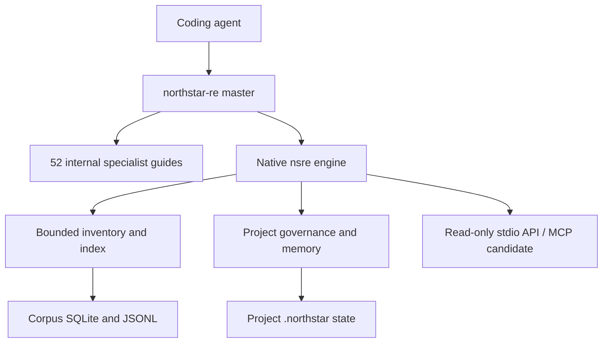
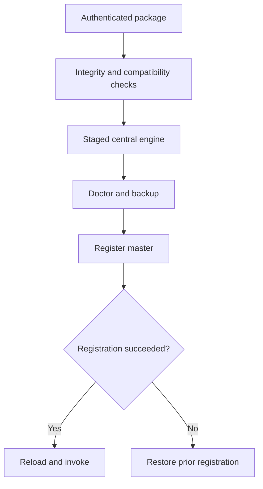

# Architecture overview

[Module contracts](../en/architecture.md) · [العربية](../ar/architecture.md)

Stages use owned paths and per-user installation. Recovery from a process kill remains an explicit acceptance concern.
