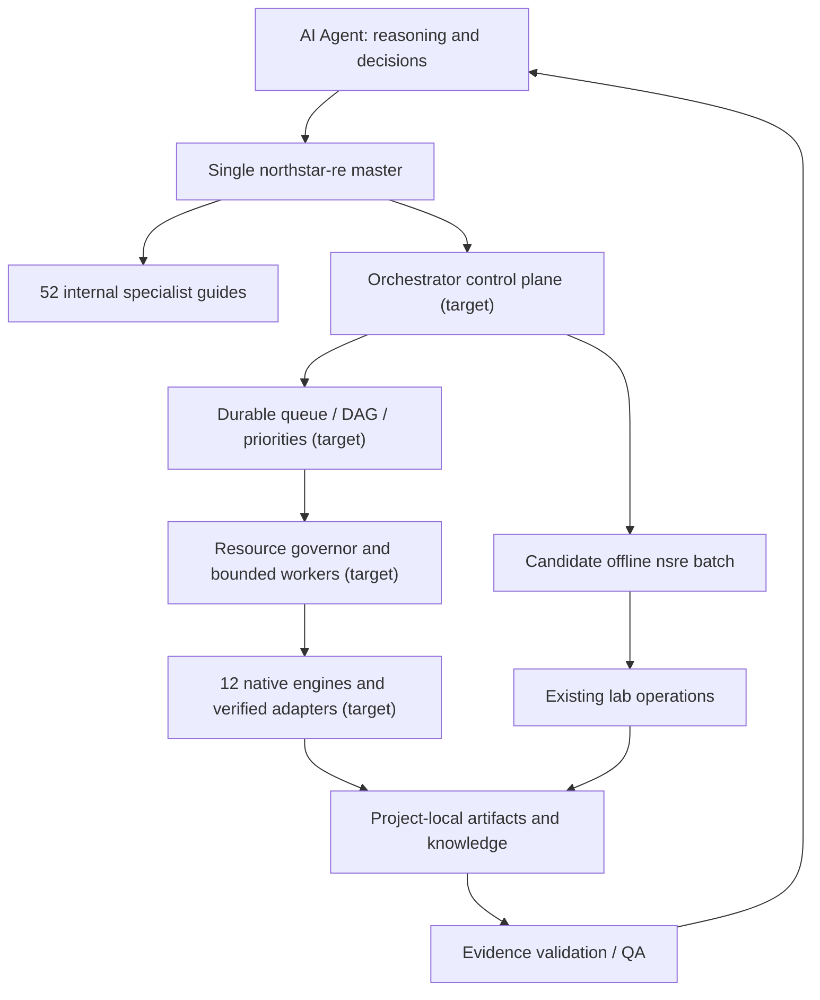
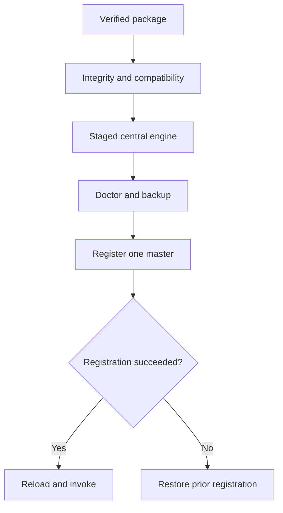

# NorthStar RE — target engineering intelligence architecture

Status: owner-approved architecture; implementation in slices. The installed RC2 remains unchanged. Current branch adds a candidate offline batch runner, discoverable engine registry and explicit durable queue, not a persistent background service. Windows 11 x64 is the sole target for future engineering and acceptance; Windows hosted CI is not desktop acceptance.

## Architectural rules
- Rust first; reuse the authoritative Cargo workspace, existing Rayon and SQLite. No extra discoverable skills or model sessions per engine.
- Separate agent control plane from execution plane. Read-only collection defaults; project-specific outputs remain local.
- Independent read jobs can overlap with agent work; dependent work waits for verified artifacts. Exclusive writes are serialized.
- Persistent queues, event delivery, cancellation, process supervision and quotas are target capabilities, not supplied by the batch command.
- An agent must inspect capabilities and host support before delegation, and must never report a planned capability as working.
- Retain original deployment, one master, 52 guides and 108 catalog entries; no Python fallback.

[Engine contract](../../skills/northstar-re/references/engine-orchestrator.md) · [Task lifecycle and acceptance](task-lifecycle.md) · [Module contracts](../en/architecture.md) · [العربية](../ar/architecture.md)

## Existing installation lifecycle

Stages use owned paths and per-user installation. Process-kill recovery remains an explicit acceptance concern.

## Platform decision

[Windows-only architecture and acceptance](windows-platform.md). Windows-native process supervision, resource governance, local IPC and diagnostics are target components; their implementation and verification remain separate gates.

## Shared Windows desktop capability

[Windows Desktop Control](desktop-control.md) extends Runtime Diagnostics; all twelve engines can consume verified observations. GUI mutations remain explicit foreground actions, not arbitrary background jobs.
