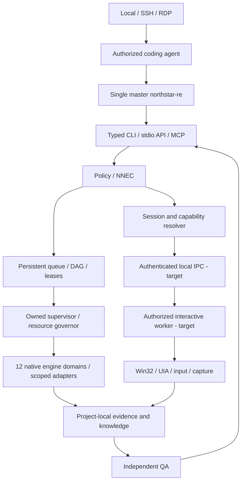

# NorthStar RE Framework — architecture

**0.012 development identity** · current and target architecture · evidence snapshot 2026-11-27, [d917cb5](https://github.com/AlMagrhibi/-NorthStar-RE-/commit/d917cb562e9248e9f5a924eda42e311899149acd).

## System boundaries

| Plane | Responsibility |
|---|---|
| Control | Discovery, typed requests, project policy and lifecycle |
| Native execution | Owned workers, deadlines, budgets, structured results |
| Interactive | Authorized session selection and serialized GUI operations |
| Data | Project SQLite, artifacts, redaction, independent provenance |
| Assurance | Verification, negative tests, local and hosted acceptance |

The twelve engine IDs are native-core, binary-intelligence, semantic-intelligence, algorithm-intelligence, data-engineering, runtime-diagnostics, compatibility, security, performance, knowledge, recovery and quality-assurance. WISM and adaptive input extend Runtime Diagnostics; no thirteenth engine. All engine completion flags remain false at the snapshot.

## Dynamic context and session mobility

Local, SSH and RDP use the same typed interface. The resolver discovers caller and target sessions from Windows. Authorization must bind user/logon identity, session generation, worker process identity and project scope, not only a hash of session/classification/lock facts. Session IDs, user names, addresses and monitor geometry are never hardcoded. Lock, unknown state, logoff or unauthorized target fail closed. A live authorized interactive worker is required for cross-session GUI tasks; no new remote listener or arbitrary shell bridge. Connection loss must not imply replay; independent owned noninteractive tasks may continue under policy. Reconnection reconciles durable state. GUI actions with uncertain effects require verification before any retry.

Current context discovery and fail-closed guards exist; watch loop, authenticated IPC, identity-bound worker and actual FreePi/SSH parity are target obligations, not proven current behavior.

## Native execution and assurance

Queue/leases/DAG and initial supervisor code exist. Verify process creation identity, OS-observed exit, atomic evidence, resource enforcement, bounded I/O and no stale publication. Execution success is distinct from verified effect. Evidence captures commit, executable hash, environment, session, timing, exit, scope and limitations. Local Windows 11, hosted CI, interactive desktop and FreePi/SSH are four independent evidence groups.

## Deployment

The authoritative workspace is `skills/northstar-re/engine/nsre`. Preserve the single master, 52 internal guides and 108 catalog entries. Native Rust x64/MSVC; no Python runtime fallback. Development packages are isolated artifacts, not publication authorization. Preserve the historical RC2 install and rollback point until unified acceptance.

[Full requirements and architecture](../NORTHSTAR-V12-EXECUTION-DIRECTIVE.md) · [Task lifecycle](task-lifecycle.md) · [Desktop control](desktop-control.md) · [Windows platform](windows-platform.md) · [Engine registry and contract](../../skills/northstar-re/references/engine-orchestrator.md) · [Version policy](../VERSIONING.md)

The previous overview is available in the [immutable historical snapshot](https://github.com/AlMagrhibi/-NorthStar-RE-/blob/d917cb562e9248e9f5a924eda42e311899149acd/docs/architecture/overview.md).
