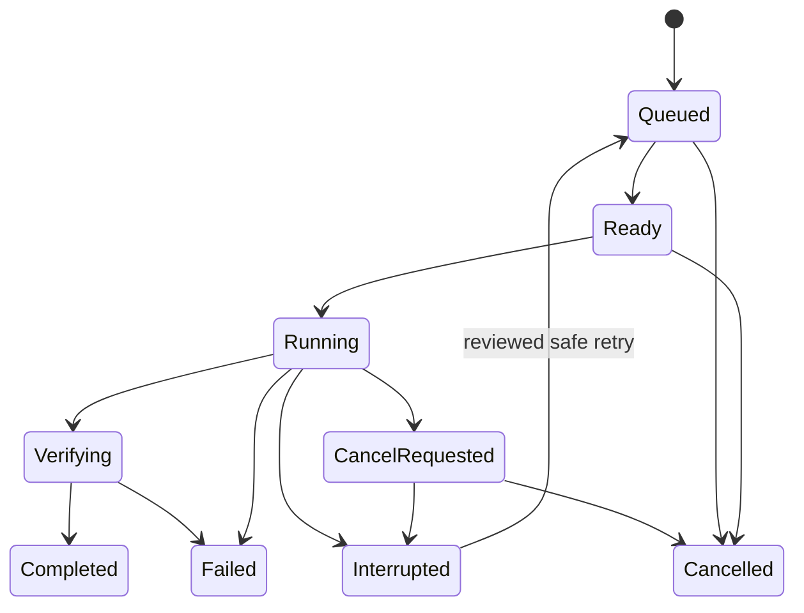

# Orchestrator task lifecycle — proposed contract v1

This document specifies the target, not an implemented service.

## Control plane
Submit returns a stable task ID without blocking on execution. Status returns the state and progress with a monotonically increasing event sequence. Wait is optional. Cancel is cooperative first; verified adapter processes require bounded termination and reconciliation. No command may report a cancelled or interrupted task as completed.

## Durable execution
A project-local SQLite queue stores versioned capability ID, immutable input digest, project scope, priority, dependencies, deadline, resource budget, attempt number and state. A transactional claim assigns a lease. Expired leases become interrupted; retries require an idempotent operation or explicit review. One writer coordinates transitions. Artifacts are separate, immutable and hashed before publication. No secrets in task manifests, logs or shared knowledge.

## Acceptance gates
| Gate | Required evidence |
|---|---|
| NSO-01 | Stable registry and bounded offline batch, success and negative fixtures |
| NSO-02 | Transactional durable queue; concurrent claims, restart and duplicate prevention |
| NSO-03 | Agent submits a job, continues unrelated work, then consumes a verified result |
| NSO-04 | DAG dependencies, cycle rejection, priorities, starvation prevention and exclusive write locks |
| NSO-05 | Cancellation, crash and timeout tests; no false completed states |
| NSO-06 | Measured resource budgets, OS enforcement for external adapters, isolated local collectors |
| NSO-07 | Provenance and hashes independently verified; stale cache invalidation |
| NSO-08 | Windows-only CI, FreePi Windows 11 desktop test, verified installation and rollback |

Current scope: NSO-01 and partial NSO-02 candidates. The remaining gates are planned. No performance gain is claimed without measurement.

## Durable queue prototype (candidate)

The new explicit queue CLI persists reviewed offline batch inputs in a dedicated SQLite database with application ID and schema version. `nsre queue init DB` creates a new database; `nsre queue submit DB ID INPUT PRIORITY WORKERS --reviewed-redacted` enqueues without executing; `nsre queue run-one DB` transactionally claims one job by priority; `nsre queue status DB ID` returns state and hash-checked results; `nsre queue cancel DB ID` cancels queued work; `nsre queue interrupt DB ID --worker-stopped` records an interrupted running job only after the operator establishes the worker stopped. The worker command is explicit: the host may launch it independently if supported. There is no autonomous daemon, lease expiry, automatic retry, running cancellation, cross-job DAG, OS quota enforcement, or live collection. Use a dedicated trusted project-local queue path and reviewed redacted inputs; no shared databases between projects. The current implementation is a candidate for NSO-02, not acceptance of NSO-02. A status query does not independently corroborate underlying lab findings.

Windows hosted process smoke is a candidate for part of NSO-02 and NSO-03, not full FreePi acceptance. See [Windows platform decision](windows-platform.md).

## Bounded dependency execution and queue drain (candidate)

Schema 1 batch tasks may declare `depends_on` as a list of task IDs in the same manifest. Unknown IDs, duplicates, self-dependencies and cycles are rejected before execution. Independent tasks in a topological layer run in parallel within the existing 1–8 worker limit; later layers wait. A dependency that fails or returns a negative check blocks dependents transitively. Output order remains input order. This is a DAG within one offline batch, not a cross-job dependency scheduler, live collector or output-passing workflow. `nsre queue drain DB LIMIT` explicitly processes at most 1–64 queued jobs in one worker process, respecting transactional claims and priority; it stops when idle or the count is reached. It does not wait for new tasks or run autonomously, and returns a negative exit status if any processed job fails. This advances part of NSO-04; acceptance remains pending Windows CI and further lifecycle work.

## Twelve-engine typed routing (candidate)

Each of the twelve registered engines now has at least one bounded executable offline operation. New operations are `content-digest` (Native Core; SHA-256 over supplied UTF-8), `binary-header` (Binary Intelligence; hexadecimal byte signature and PE signature hint, not full parser), `semantic-reachability` (Semantic Intelligence; directed graph traversal on supplied nodes and edges, not extraction), and `checkpoint-compare` (Recovery; compare supplied expected/actual manifests, not restore or independent file hashing). Batch tasks optionally declare `engine`; mismatched operation ownership is rejected before execution. Results identify the registered engine. Tests cover registry ownership, graph cycles, malformed hex, digest vectors and negative checkpoint differences. This is a typed offline execution foundation; all engine completion flags remain false until full acceptance. No target execution, live data collection, or automatic recovery is implied.

## Local file evidence collector (candidate)

`nsre collect --root DIR --input FILE --out NEW_FILE --jobs N --reviewed-redacted` uses schema 1 `{ "schema":1, "files":[{"path":"relative/file.dat","expected_sha256":"optional 64 hex characters"}] }`. It independently streams SHA-256 and bounded signature/entropy hints from selected local files; up to 64 entries, 64 MiB per file, 1–8 workers. It reports mismatch and access errors as negative results and refuses output inside the source tree or existing output. It rejects reparse points, nonregular files and path traversal; use a trusted stable workspace, not an adversarial filesystem (TOCTOU is not eliminated). This shared CLI advances Native Core, Binary Intelligence, Knowledge, Recovery and QA, but is not yet callable through the offline queue and does not perform restore, full format validation, or live process collection. No engine completion flags change. Windows acceptance pending.

The hosted Windows smoke now also invokes one synthetic operation per registered engine in a single 12-task batch with three dependency layers and checks all distinct engine IDs and results. This validates dispatch wiring, not full engine functionality, production evidence, or desktop acceptance. All inputs are synthetic.

## Queue wait, provenance and reviewed recovery (candidate)

`nsre queue wait DB ID SECONDS` polls an existing job for at most 0–600 seconds (SQLite busy handling may extend a poll); returns the current report and terminal/timeout flags, exit 0 only for completed, exit 2 for timeout or unsuccessful terminal state. Status and wait recompute the stored input and result hashes, reject inconsistent state/result, and expose both digests. `nsre queue retry DB OLD_ID NEW_ID --reviewed-redacted` creates a new immutable job from an intact interrupted offline input, preserving the original record and original priority/worker settings. It requires a fresh ID and operator-reviewed interruption after verifying the previous worker stopped; it is not automatic crash detection, a lease, an autonomous retry service or proof of independent source evidence. Tests include duplicate retry, timeout, interrupted record preservation, and input corruption. Hosted Windows smoke checks wait and input/result digests. No completion flags are changed.
