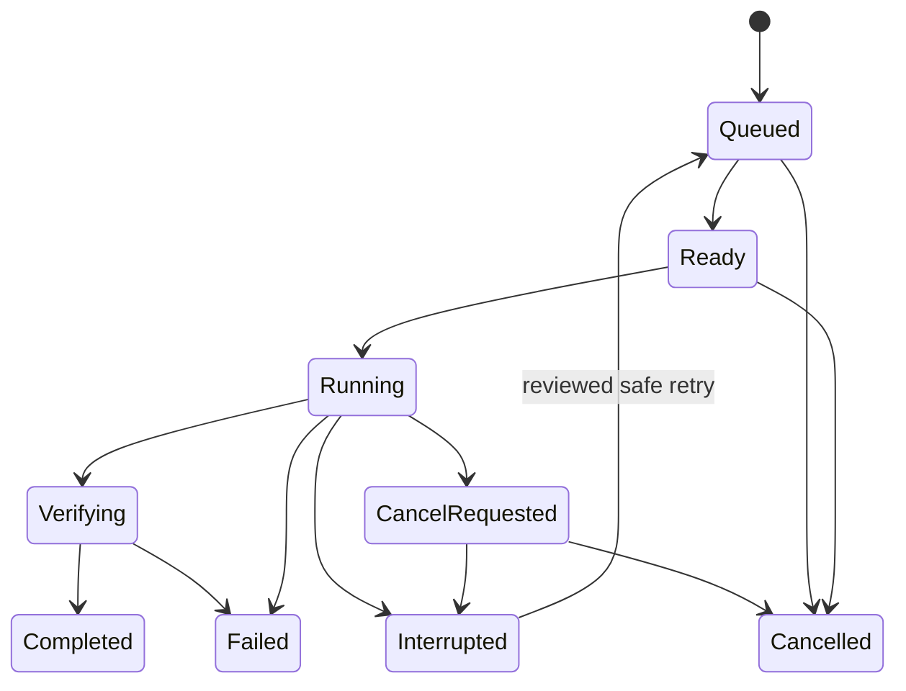

# Orchestrator task lifecycle — proposed contract v1

This document specifies the target, not an implemented service.

## Control plane
Submit returns a stable task ID without blocking on execution. Status returns the state and progress with a monotonically increasing event sequence. Wait is optional. Cancel is cooperative first; verified adapter processes require bounded termination and reconciliation. No command may report a cancelled or interrupted task as completed.

## Durable execution
A project-local SQLite queue stores versioned capability ID, immutable input digest, project scope, priority, dependencies, deadline, resource budget, attempt number and state. A transactional claim assigns a lease. Expired leases become interrupted; retries require an idempotent operation or explicit review. One writer coordinates transitions. Artifacts are separate, immutable and hashed before publication. No secrets in task manifests, logs or shared knowledge.

## Acceptance gates
| Gate | Required evidence |
|---|---|
| NSO-01 | Stable registry and bounded offline batch, success and negative fixtures |
| NSO-02 | Transactional durable queue; concurrent claims, restart and duplicate prevention |
| NSO-03 | Agent submits a job, continues unrelated work, then consumes a verified result |
| NSO-04 | DAG dependencies, cycle rejection, priorities, starvation prevention and exclusive write locks |
| NSO-05 | Cancellation, crash and timeout tests; no false completed states |
| NSO-06 | Measured resource budgets, OS enforcement for external adapters, isolated local collectors |
| NSO-07 | Provenance and hashes independently verified; stale cache invalidation |
| NSO-08 | Windows and Linux CI, FreePi Windows desktop test, verified installation and rollback |

Current scope: NSO-01 candidate only. The remaining gates are planned. No performance gain is claimed without measurement.

## Durable queue prototype (candidate)

The new explicit queue CLI persists reviewed offline batch inputs in a dedicated SQLite database with application ID and schema version. `nsre queue init DB` creates a new database; `nsre queue submit DB ID INPUT PRIORITY WORKERS --reviewed-redacted` enqueues without executing; `nsre queue run-one DB` transactionally claims one job by priority; `nsre queue status DB ID` returns state and hash-checked results; `nsre queue cancel DB ID` cancels queued work; `nsre queue interrupt DB ID --worker-stopped` records an interrupted running job only after the operator establishes the worker stopped. The worker command is explicit: the host may launch it independently if supported. There is no autonomous daemon, lease expiry, automatic retry, running cancellation, DAG, OS quota enforcement, or live collection. Use a dedicated trusted project-local queue path and reviewed redacted inputs; no shared databases between projects. The current implementation is a candidate for NSO-02, not acceptance of NSO-02. A status query does not independently corroborate underlying lab findings.
